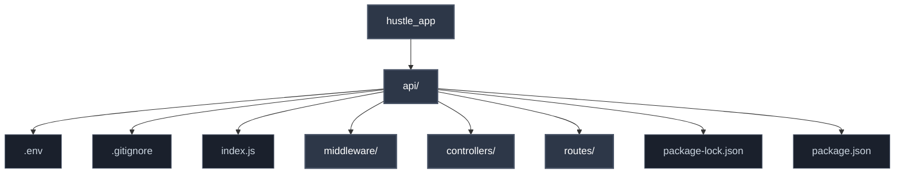
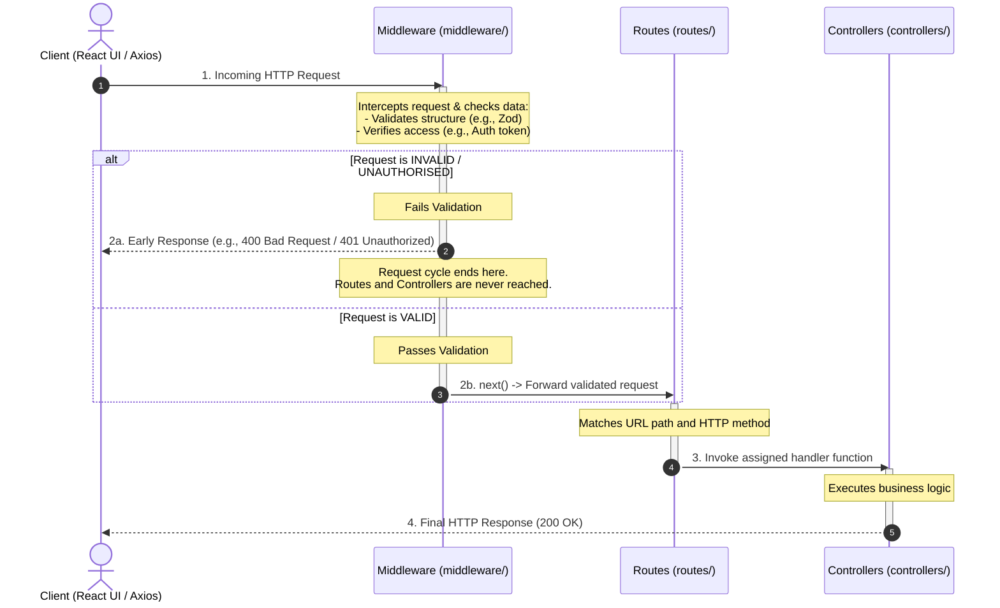
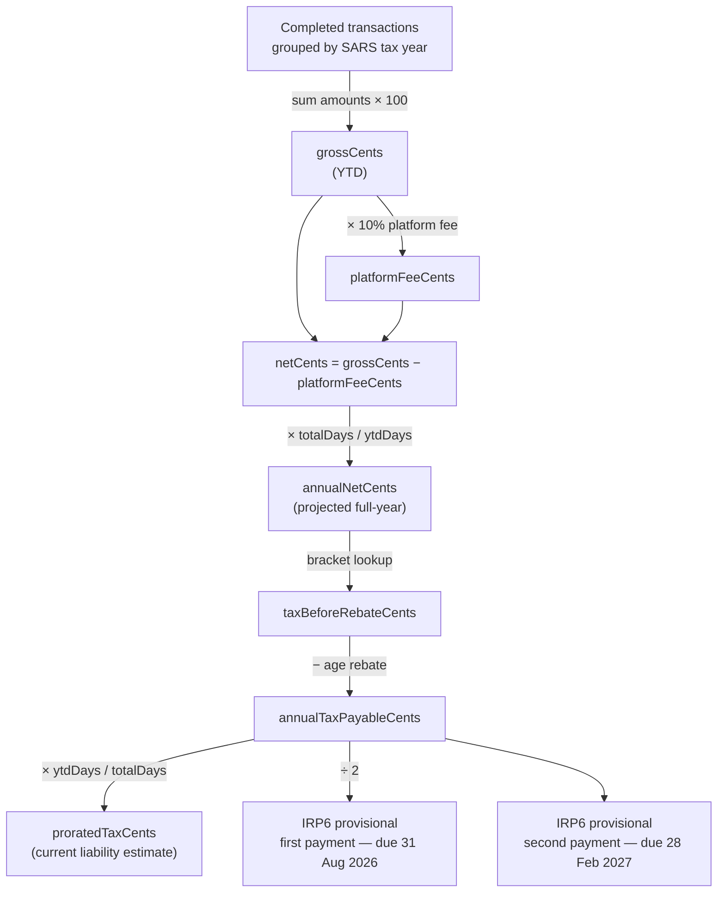
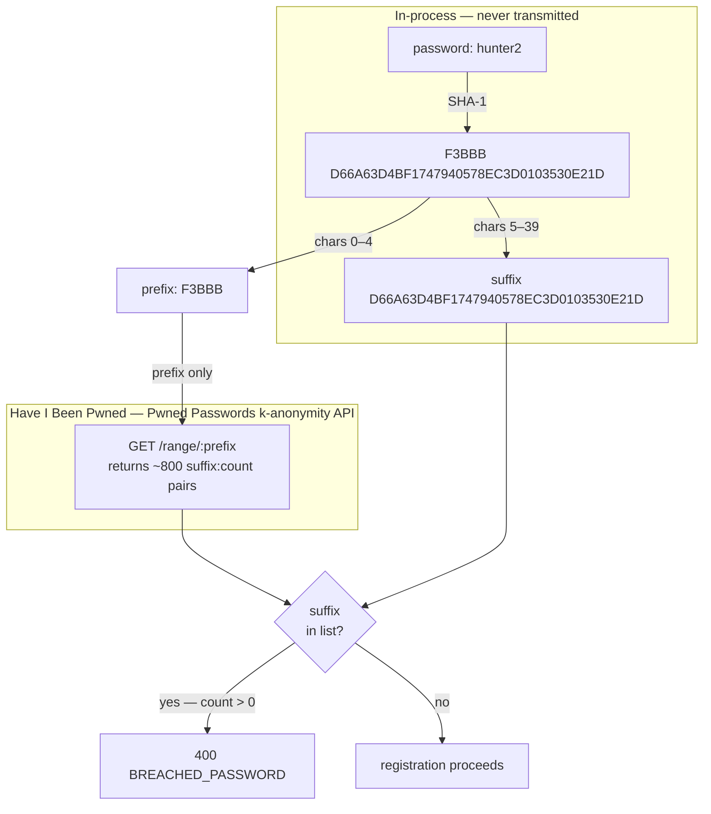
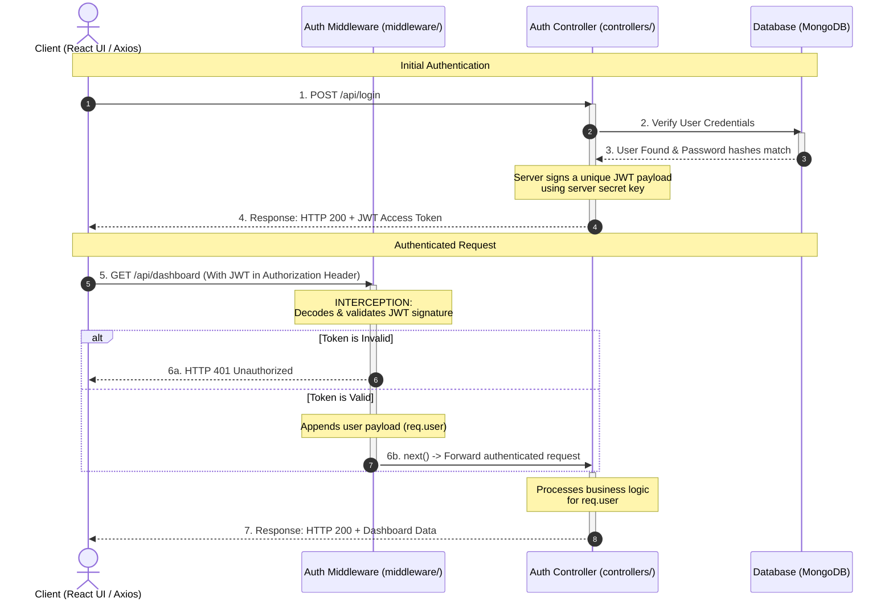

# HustleHub+

The HustleHub+ system is a freelance marketplace platform that facilitates the advertisement and browsing of listed services. The system processes sensitive personable identifiable and financial information related to the booking of services. This make it imperative that the system be designed and implemented in a security conscious manner to proactively mitigate and prevent attack vectors that could be leveraged to compromise its integrity. 

## <u>How to Start Client</u>
Below are the instrctions for running the client, please not you will need to open 2 seperate terminals:

How to Run The Backend
Run the following commands:
- cd backend
- npm install
- npm start

How to Run The Frontend
Runn the following commands:
- cd frontend
- npm install
- npm run dev

The Following vredentials can be used:
|connor@example.com|Password1!|Client|
|jessica@example.com|Password1!|Freelancer|
|admin@hustlehub.example.com|Password1!|Admin|

## Demo

### Admin Credentials 

Username: 

```
admin@hustlehub.example.com
```
Password:
```
Password1!
```

### Client Credentials 

Username: 

```
connor@example.com
```
Password:
```
Password1!
```

### Freelancer Credentials 

Username: 

```
jessica@example.com
```
Password:
```
Password1!
```

### Demo Videos
#### Part 1
See the HustleHub+ Part 1 Postman Demo [Video](https://youtu.be/PlD6tQwKoPI).
#### Part 2
See the HustleHub+ Part 2 Showcase [Video](https://www.youtube.com/watch?v=JFhXcax6Bbg).
#### POE
See the HustleHub+ POE Showcase **TODO: Make Showcase and link here as above**

### Asciinema Demo
```sh
cd backend # ensure that you're in the backend dir
npm install && npm run test # install dependencies and run tests
npm run demo # demonstrate tests, run postman collection, etc. 
```


## Team Member Details
See [TEAM.md](</TEAM.md>) for team member details including student and group numbers.

## HustleHub+ User Matrix

| User Role      | System Description                                                                         | Core Responsibilities & Permissions                                                                                                                                                                                                                     |
| :------------- | :----------------------------------------------------------------------------------------- | :------------------------------------------------------------------------------------------------------------------------------------------------------------------------------------------------------------------------------------------------------ |
| **Client**     | Standard consumers who browse, discover, and book freelance services on the platform.      | • **Browse Services:** Browse listed gigs.<br>• **Manage Bookings:** Book services and view automated booking confirmations and histories.                                                                                                              |
| **Freelancer** | Service providers who market their skills, advertise listed services, and manage bookings. | • **Gig Management:** Create, update, view, and delete their own advertised service listings.<br>• **Track Revenue:** View income generated from pending and completed bookings.<br>• **Booking Management:** View and manage incoming client bookings. |
| **Admin**      | System administrators responsible for platform health and global user management.          | • **System Monitoring:** Monitor system performance and endpoint activity.<br>• **Platform Governance:** Oversee global user accounts, active service listings, and bookings.                                                                           |


# Architecture 

The HustleHub+ system is a freelance marketplace platform that facilitates the advertisement and browsing of listed services. The system processes sensitive personable identifiable and financial information related to the booking of services. This make it imperative that the system be designed and implemented in a security conscious manner to proactively mitigate and prevent attack vectors that could be leveraged to compromise its integrity. 

The design of the system and implementation follows the MERN architecture and is comprised of the following components: 

- MongoDB - document database 
- Express(.js) - Node.js web framework 
- React(.js) - Front-end JavaScript framework
- Node(.js) - JavaScript web server (runtime)

The below diagram visualises the MERN architecture at a high-level: 


## Architecture diagram 

The architecture diagram illustrates the MERN architectural model and its organisation into four decoupled layers which establishes security boundaries to protect user data as it moves throughout the system: 


### Client Layer (React)

The frontend serves as the initial line of defense, focusing on input sanitization and input validation. The React User Interface (UI) components leverage React's built-in HTML encoding to automatically escape markdown or code, neutralising code injection risks [[1]](https://www.zotero.org/google-docs/?NR2v8X). The React Hook Form Context and Zod Schemas enforce client-side input validation rules [[2], [3]](https://www.zotero.org/google-docs/?e9wkI7). By validating types, lengths, and formats, the system prevents malformed payloads from causing unnecessary network traffic or server stress . The Axios client intercepts outgoing requests to uniformly attach authentication tokens (JWTs) and anti-CSRF tokens [[4]](https://www.zotero.org/google-docs/?LXz2I3).

### Network Security Layer

This layer establishes a security boundary between the untrusted public internet and the backend infrastructure. HTTPS / TLS Encryption forces all data in transit to be encrypted. This mitigates Man-in-the-Middle (MITM) attacks and ensures packet confidentiality and integrity between the client browser and the server endpoint [[5], [6]](https://www.zotero.org/google-docs/?wygNgb).

### Server Layer (Node/Express Backend)

The backend acts as the gatekeeper and final line of defence, treating all incoming client requests as fundamentally untrusted. helmet, express-validator and cors act as the backend's middleware providing server-side validation and configure HTTP response headers to force browsers to implement execution rules that mitigate clickjacking, MIME-type sniffing, and cross-origin security vulnerabilities [[7], [8], [9]](https://www.zotero.org/google-docs/?bYgTfx). The Mongoose ODM acts to serialise and parameterise data queries, mitigating NoSQL Injection and corruption of system data [[10], [11]](https://www.zotero.org/google-docs/?wO29P8).

The API project be organised into the following structure: 




| Folder       | Purpose                                                                                                                                                                                   |
| ------------ | ----------------------------------------------------------------------------------------------------------------------------------------------------------------------------------------- |
| routes/      | Defines endpoint paths for client requests and maps them to controller functions                                                                                                          |
| controllers/ | Contains the logic that handles incoming requests sent to the various route endpoints and coordinates the business logic to produce appropriate system responses.                         |
| middleware/  | Contains the processing, validation and error handling logic for requests sent to the various endpoints on the server, acting as an intermediary before the controller logic is executed. |


The below sequence diagram represents a request lifecycle through the backend application, exemplifying the flow of a request before it reaches a controller:



# Tax Engine (own feature)

The HustleHub+ platform includes a freelancer income-tax estimation engine (`src/lib/estimateTax.js`) that applies the South African Revenue Service (SARS) 2026/27 individual income-tax tables to a freelancer's completed transaction history. The engine is exposed via the authenticated endpoint `GET /api/me/income-summary` and is restricted to users with the `freelancer` role.

## Design Principles

All monetary values are stored and computed as **integer cents** (1/100 rand) throughout the engine. This eliminates floating-point rounding errors that accumulate when performing repeated multiplication on decimal rand amounts — a known hazard in financial calculations. Tax rates are stored in **basis points** (bps, where 10 000 bps = 100%) for the same reason, keeping every arithmetic step in integer space.

The tax year follows the SARS convention: **1 March of year N to the last day of February of year N+1**. All date boundaries are computed in South African Standard Time (SAST, UTC+2) so that transactions recorded near midnight are attributed to the correct tax year.

## SARS 2026/27 Tax Brackets

The engine uses the following seven-bracket schedule (per `src/data/sars-2026-27.json`):

| Taxable income (rand)         | Rate  |
| ----------------------------- | ----- |
| R0 – R245 900                 | 18%   |
| R245 901 – R383 900           | 26%   |
| R383 901 – R532 000           | 31%   |
| R532 001 – R698 100           | 36%   |
| R698 101 – R890 100           | 39%   |
| R890 101 – R1 886 900         | 41%   |
| R1 886 901+                   | 45%   |

Tax within a bracket is computed as: `baseTax + round((income − threshold) × rateBps / 10000)`.

## Age-Based Rebates

SARS allows natural persons to deduct a primary rebate from gross tax before arriving at tax payable. Additional rebates apply at ages 65 and 75:

| Rebate    | Applies to          | Amount (rand) |
| --------- | ------------------- | ------------- |
| Primary   | All taxpayers       | R17 820       |
| Secondary | Age 65–74           | + R9 774      |
| Tertiary  | Age 75+             | + R3 267      |

## Calculation Flow



## Annualisation and Pro-Rating

Because freelancers earn irregularly throughout the year, a snapshot taken mid-year would understate the annual tax liability. The engine annualises the YTD net income to a projected full-year figure before applying the bracket table, then pro-rates the resulting annual tax back to the elapsed days:

```javascript
// Annualise YTD net income
const annualNetCents = Math.round(netCents * totalDays / ytdDays);

// Compute annual tax on the projected figure, then pro-rate
const proratedTaxCents = Math.round(annualTaxPayableCents * ytdDays / totalDays);
```

This approach mirrors the SARS provisional tax methodology and gives freelancers a realistic current-period liability rather than a figure that grows only as income accumulates.

## Provisional Tax (IRP6)

Freelancers who are not employees are required to pay provisional tax. The engine calculates the two IRP6 instalment amounts directly from the annual tax estimate and returns the SARS filing deadlines:

| Payment        | Amount                   | Deadline      |
| -------------- | ------------------------ | ------------- |
| First payment  | 50% of annual estimate   | 31 Aug 2026   |
| Second payment | Remaining 50%            | 28 Feb 2027   |
| Voluntary top-up | Any shortfall           | 30 Sep 2027   |

## Example Response

```json
{
  "freelancerId": "68210fc2a1b2c3d4e5f67890",
  "generatedAt": "2026-11-08T13:00:00.000Z",
  "summary": [
    {
      "taxYear": "2026/27",
      "taxYearPeriod": { "start": "2026-03-01", "end": "2027-02-28", "totalDays": 365, "ytdDays": 253 },
      "transactionCount": 12,
      "grossIncomeCents": 45000000,
      "platformFeeRateBps": 1000,
      "platformFeeCents": 4500000,
      "netIncomeCents": 40500000,
      "annualNetIncomeCents": 58400237,
      "taxEstimate": {
        "taxBeforeRebateCents": 14172673,
        "rebateCents": 1782000,
        "annualTaxPayableCents": 12390673,
        "proratedTaxCents": 8582671,
        "effectiveRatePct": "21.21%",
        "marginalRatePct": "31.00%",
        "provisionalTax": {
          "firstPaymentCents": 6195336,
          "secondPaymentCents": 6195337,
          "dates": { "firstDeadline": "2026-08-31", "secondDeadline": "2027-02-28", "topUpDeadline": "2027-09-30" }
        }
      }
    }
  ]
}
```

# System Security

## Client-side Input validation

Input validation is a security consideration that will be implemented in the React front-end and acts as the first preventative security layer that stops malformed or malicious input/requests from reaching the server. However, it should be noted that client-side validation can be trivially bypassed, therefore it remains crucial to implement server-side validation and sanitisation of requests [[1]](https://www.zotero.org/google-docs/?ZXMseD).

### Type checking

Type checking ensures that input fields submitted match the exact primitive or data structure expected. This will be implemented in the Client-side application (React) using Zod to enforce primitives/data structures before submission [[3]](https://www.zotero.org/google-docs/?XXoXSi).

The following will be validated using a type checking using Zod defined schema for each primary entity within the HustleHub+ system:
#### User Entity Schema

```javascript
export const UserTypeSchema = z.object({
  id: z.string(),
  email: z.string(),
  password: z.string(),
  is_active: z.boolean(),
  is_verified: z.boolean(),
});
```

#### Freelancer Profile Entity Schema

```javascript
export const FreelancerProfileTypeSchema = z.object({
  user_id: z.string(),
  first_name: z.string(),
  last_name: z.string(),
  bio: z.string(),
  phone_number: z.string(),
  hourly_rate: z.number(),
  skills: z.array(z.string()),
});
```

#### Service Entity Schema

```javascript
export const ServiceTypeSchema = z.object({
  id: z.string(),
  freelancer_id: z.string(),
  title: z.string(),
  description: z.string(),
  base_price: z.number(),
  category: z.string(),
});
```

#### Booking Entity Schema

```javascript
export const BookingTypeSchema = z.object({
  id: z.string(),
  client_id: z.string(),
  service_id: z.string(),
  scheduled_start: z.string(),
  scheduled_end: z.string(),
  status: z.string(),
  requirements_note: z.string().optional(),
});
```

#### Transaction Entity Schema

```javascript
export const TransactionTypeSchema = z.object({
  id: z.string(),
  booking_id: z.string(),
  amount: z.number(),
  currency: z.string(),
  payment_gateway_reference: z.string(),
});
```

### Length Limits

Length limits ensure that user submitted input conforms to a pre-defined length before submission to the server. The restriction of the input length supports the mitigation of denial of service attacks that leverage large inputs to reduce system responsiveness. This will be implemented in the Client-side application (React) using Zod [[3]](https://www.zotero.org/google-docs/?JbOloE).

The below Zod entity schema have been revised to showcase how the length limitations will be implemented in the validation of client-side inputs related to primary entities within the system:
#### User Entity Schema

```javascript
export const UserLengthSchema = z.object({
  id: z.string(),
  email: z.string()
    .min(5, { message: "Email must be at least 5 characters" })
    .max(254, { message: "Email cannot exceed 254 characters" }),
  password: z.string()
    .min(12, { message: "Password must be at least 12 characters" })
    .max(72, { message: "Password cannot exceed 72 characters" }),
  is_active: z.boolean(),
  is_verified: z.boolean(),
});
```

#### Freelancer Profile Entity Schema

```javascript
export const FreelancerProfileLengthSchema = z.object({
  user_id: z.string(),
  first_name: z.string()
    .min(1, { message: "First name is required" })
    .max(50, { message: "First name cannot exceed 50 characters" }),
  last_name: z.string()
    .min(1, { message: "Last name is required" })
    .max(50, { message: "Last name cannot exceed 50 characters" }),
  bio: z.string()
    .max(1000, { message: "Bio cannot exceed 1000 characters" }),
  phone_number: z.string()
    .min(7, { message: "Phone number must be at least 7 characters" })
    .max(15, { message: "Phone number cannot exceed 15 characters" }),
  hourly_rate: z.number(),
  skills: z.array(z.string().min(1)),
});
```
#### Service Entity Schema

```javascript
export const ServiceLengthSchema = z.object({
  id: z.string(),
  freelancer_id: z.string(),
  title: z.string()
    .min(10, { message: "Title must be at least 10 characters" })
    .max(100, { message: "Title cannot exceed 100 characters" }),
  description: z.string()
    .min(50, { message: "Description must be at least 50 characters" })
    .max(2000, { message: "Description cannot exceed 2000 characters" }),
  base_price: z.number(),
  category: z.string(),
});
```

#### Booking Entity Schema

```javascript
export const BookingLengthSchema = z.object({
  id: z.string(),
  client_id: z.string(),
  service_id: z.string(),
  scheduled_start: z.string(),
  scheduled_end: z.string(),
  status: z.string(),
  requirements_note: z.string()
    .max(500, { message: "Requirements note cannot exceed 500 characters" })
    .optional(),
});
```

#### Transaction Entity Schema

```javascript
export const TransactionLengthSchema = z.object({
  id: z.string(),
  booking_id: z.string(),
  amount: z.number(),
  currency: z.string()
    .length(3, { message: "Currency must be exactly 3 characters" }),
  payment_gateway_reference: z.string()
    .min(10, { message: "Gateway reference must be at least 10 characters" })
    .max(128, { message: "Gateway reference cannot exceed 128 characters" }),
});
```

### Format constraints

Format constraint in terms of client-side validation refers to the process of utilising a regular expression (REGEX) to determine whether an input matches a specific pattern that constitutes valid input [[3], [12], [13]](https://www.zotero.org/google-docs/?4JvjmH). Zod has again been used for input validation using the String Formats provided by the library to implement common string format constraints on the email field of users. However, other fields such as password, phone_number have used the string primitive type with the pattern param to define a custom regex expression for validation. This provides an additional layer to client-side input validation that acts to improve the integrity of the data submitted to the server [[3]](https://www.zotero.org/google-docs/?gYe1jx).

The below Zod entity schema have been revised to showcase how format constraints will be implemented in the validation of client-side inputs related to primary entities within the system:

#### User Entity Schema

```javascript
export const UserFormatSchema = z.object({
  id: z.string(),
  email: z.string().email({ message: "Must match RFC 5322 standard layout" }),
  password: z.string().regex(/(?=.*[a-z])(?=.*[A-Z])(?=.*[0-9])(?=.*[!@#\$%^&*])/, {
    message: "Must include minimum character diversity (uppercase, lowercase, number, special sign)",
  }),
  is_active: z.boolean(),
  is_verified: z.boolean(),
});
```

####  Freelancer Profile Entity Schema

```javascript
export const FreelancerProfileFormatSchema = z.object({
  user_id: z.string(),
  first_name: z.string().regex(/^[A-Za-zÀ-ÿ\s'-]+\$/, { 
    message: "First name must only contain alphanumeric characters" 
  }),
  last_name: z.string().regex(/^[A-Za-zÀ-ÿ\s'-]+\$/, { 
    message: "Last name must only contain alphanumeric characters" 
  }),
  bio: z.string(),
  phone_number: z.string().regex(/^\+[1-9]\d{1,14}\$/, { 
    message: "Must adhere strictly to international E.164 configuration protocols" 
  }),
  hourly_rate: z.number().multipleOf(0.01, { 
    message: "Must be constrained to a maximum of two decimal places" 
  }),
  skills: z.array(z.string()),
});
```

--- 
### Output Escaping

Input validation and output escaping are complementary security practices. Output escaping (or encoding) transforms data so it renders safely in the destination context (HTML, URLs, JavaScript, CSS) [[14]](https://www.zotero.org/google-docs/?lpEI5i).

#### React Built-in HTML Escaping (Context aware escaping)

The default behaviour of React automatically HTML-escapes all JSX text and attribute values before rendering them to the Document Object Model (DOM) when utilising the curly braces {}. This effectively encodes dangerous characters (<, >, &, ", ') present in user input into HTML entities (&lt;, &gt;, &amp;, &quot;, &#x27;) that are safe for rendering, whereby the browser will not interpret them as markup or executable JavaScript code [[1], [14]](https://www.zotero.org/google-docs/?mZv8c3).

Fundamentally, this security implementation enforces a strict separation between data which is positioned within the curly braces for encoding and markup which is inserted into JSX tags. This is achieved at render time in the renderToString and DOM-mount pipelines whereby the React DOM render applies context aware escaping before inserting each value into the DOM, making XSS nearly impossible when rendering dynamic user generated content [[1], [14]](https://www.zotero.org/google-docs/?2RRxBR).

For instance the following will be applied to the rendering dynamic user generated content such as service reviews on the platform:

```javascript
const userReview = "";
return <div>{userComment}</div>;
```

Therefore, basic output escaping will be Incorporated by default in the client-side application. However, the default escaping provided fails to escape the output in the following cases:

- String attribute bindings
- JavaScript expressions inside dangerouslySetInnerHTML
- Event handlers from strings
    
These exceptions leave the client-application vulnerable to cross-site scripting (XSS) in the eventuality there is some failure in server-side validation that allows code/markup to be rendered within the DOM [[1], [14]](https://www.zotero.org/google-docs/?DQLmZr). In order to address these concerns manual sanitisation will be implemented, which will be discussed in greater detail later.

--- 
### Sanitisation

The default output encoding supported by React is insufficient in circumstances where the system requires raw HTML to be rendered to the DOM. The React API exposes dangerouslySetInnerHTML that enables an element's innerHTML property to be set directly bypassing the default HTML encoding mentioned above. However, in the context of the system the rendering of HTML content might be completely justified for freelancers creating service listings using Rich-text editors for purposes of formatting the content of their listing [[14], [15]](https://www.zotero.org/google-docs/?IIv2km).

However, when you pass unsanitised user input to dangerouslySetInnerHTML, you enable arbitrary code execution. Therefore sanitisation is necessary to mitigate the ACE vulnerability presented through the use of this API [[15]](https://www.zotero.org/google-docs/?1aJpTZ). The below code snippet exemplifies how dangerouslySetInnerHTML can be abused:

```javascript
function ServiceListingDisplay({ serviceListing }) {
  // UNSAFE: serviceListing might contain <script> tags or event handlers
  // serviceListing = ''
  return <div dangerouslySetInnerHTML={{ __html: userComment }} />;
}
```

Upon failure to render the image the onerror event will fire executing the specified JavaScript payload. In the above example this will ex-filtrate the cookies of the user that views the service listing to the threat actors infrastructure.
#### DOMPurify 

Sanitisation of the user specified service listing HTML will be achieved using DOMPurify, an industry standard sanitization library. DomPurify removes event handlers, script tags and returns a safe subset of HTML elements that can be rendered in the DOM without the possibility of introducing ACE vulnerabilities [[15]](https://www.zotero.org/google-docs/?6icMxK). The below example, showcases how DOMPurify will be implemented in the client to mitigate the risk associated with the dangerouslySetInnerHTML API:

```javascript
function CommentDisplay({ userComment }) {
  const clean = DOMPurify.sanitize(userComment);
// serviceListing = ''
// DOMPurify removes the onerror attribute and returns:
// ''
  return <div dangerouslySetInnerHTML={{ __html: clean }} />;
}
```

Furthermore, a whitelist will be defined in DOMPurify to control the type of formatting allowed for service listings. This enables fine-grained control to be exercised over the elements that a user can provide for rendering on the DOM [[15]](https://www.zotero.org/google-docs/?5djGAz). The below implementation, showcases how this may be designed in the eventuality that style tags, script tags and event tags are prohibited:

```javascript 
function DisplayServiceListing ({ serviceListingHTML }) {
  const config = {
    ALLOWED_TAGS: ['p', 'br', 'strong', 'em', 'a', 'ul', 'ol', 'li', 'blockquote'],
    ALLOWED_ATTR: ['href', 'title'],
    ALLOW_UNKNOWN_PROTOCOLS: false,
  };
  
  const clean = DOMPurify.sanitize(serviceListingHTML, config);
  return <div dangerouslySetInnerHTML={{ __html: clean }} />;
}
```

However, it should be noted that DOMPurify cannot be relied upon exclusively to remove all XSS attack vectors and will be paired with a Content Security Policy (CSP) to improve the robustness of the system's security. Lastly, despite the implementation of back-end sanitisation, the network should never be trusted [[15]](https://www.zotero.org/google-docs/?lkyCam). Therefore, sanitisation will always occur in the React client to mitigate circumstances whereby the HTML might be modified by a proxy or intercepted during transmission before being rendered on the client [[15]](https://www.zotero.org/google-docs/?VwdnCN).

---
## Server-side input validation 

As previously mentioned client-side validation of user input is not sufficient. The system incorporates server-side input validation to account for these inadequacies, using the `express-validator` package.

### Handle Validation Errors

The middleware exposes the function `handleValidationErrors` that aggregates validation errors generated by upstream filters, blocks malformed cycles by returning an HTTP 400 Bad Request, and exposes structured error details.

```javascript 
const handleValidationErrors = (req, res, next) => {
    // If validation errors exist, return a 400 Bad Request response with the error details
    const errors = validationResult(req);

    if (!errors.isEmpty()) {
        return res.status(400).json({
            error: {
                code: 'VALIDATION_ERROR',
                message: "Invalid request data",
                details: errors.array().map((error) => ({
                    field: error.path,
                    message: error.msg,
                })),
            },
        });
    }

    next();
}
```

### Register Validation

The middleware exposes the array `registerValidation` that filters registration payloads by blocking unknown properties, enforcing email length (max 254 characters), enforcing complex passwords within an 8–128 character boundary, and restricting roles to a whitelist (**`client`**, **`freelancer`**, or **`admin`**). This ensures that user registration requests that have malformed properties do not reach controllers isolating the core system logic from malicious data structures.

```javascript 
const registerValidation = [
    rejectUnknownFields(['email', 'password', 'role']),
    body('email')
    .exists({checkFalsy: true}).withMessage('Email is required')
    .bail().trim().isLength({max:254}).withMessage('Email must not exceed 254 characters')
    .bail().isString().withMessage('Email must be a string')
    .bail().trim().isEmail().withMessage('Email must be a valid email address')
    .normalizeEmail(),

    body('password')
    .exists({checkFalsy: true}).withMessage('Password is required')
    .bail().isString().withMessage('Password must be a string')
    .bail().matches(/^(?=.*[a-z])(?=.*[A-Z])(?=.*\d)(?=.*[^A-Za-z0-9\s]).{8,128}$/).withMessage('Password must be complex and between 8 to 128 characters'),

    body("role")
    .optional()
    .isString().withMessage('Role must be a string')
    .bail().trim().toLowerCase().isIn(['client', 'freelancer','admin']).withMessage('Role must be either "client", "freelancer" or "admin"'),

    handleValidationErrors,
];
```

### Breached Password Check (HIBP) (own feature)

To comply with NIST SP 800-63B §5.1.1, registration additionally enforces a minimum password length of 8 characters and verifies that the submitted password has not appeared in a known data breach. This is achieved using the HaveIBeenPwned (HIBP) Pwned Passwords range API [[27]](https://haveibeenpwned.com/API/v3#SearchingPwnedPasswordsByRange).

The check employs a k-anonymity model to protect user privacy during the lookup. Only the first 5 hexadecimal characters of the SHA-1 hash of the submitted password are transmitted to the HIBP API. The API returns all hash suffixes that share this prefix, each paired with a breach count. The remaining 35 characters of the locally computed hash are then compared against the returned suffixes in-process. Neither the plaintext password nor a recoverable portion of its hash is ever exposed to the external service.



If the suffix is present in the API response with a breach count greater than zero, the registration request is rejected with `400 BREACHED_PASSWORD`. The check is designed to fail open: if the HIBP API is unreachable during a third-party outage, a warning is emitted to the structured logger and registration proceeds, preserving system availability.

```javascript
// NIST SP 800-63B §5.1.1 minimum length
if (!password || password.length < MIN_PASSWORD_LENGTH)
  return res.status(400).json({
    error: { code: "WEAK_PASSWORD", message: `Password must be at least ${MIN_PASSWORD_LENGTH} characters.` },
  });

// HIBP k-anonymity breached-password check
try {
  const breachCount = await checkPwnedPassword(password);
  if (breachCount > 0) {
    return res.status(400).json({
      error: {
        code: "BREACHED_PASSWORD",
        message: "This password has appeared in a known data breach. Please choose a different password.",
      },
    });
  }
} catch (hibpErr) {
  logger.warn("HIBP check failed – proceeding with registration", {
    event: "auth.register.hibp_error",
    error: hibpErr.message,
    ip: req.ip,
  });
}
```

### Login Validation 

The middleware exposes the array `loginValidation` that filters login payloads by blocking unknown properties, enforcing strict email formatting requirements, and validating password presence and type constraints up to a 128-character maximum. This ensures that user login requests that have malformed properties do not reach controllers, isolating the core system logic from malicious data structures.

```javascript
const loginValidation = [
    rejectUnknownFields(['email', 'password']),
    body('email')
    .exists({checkFalsy: true}).withMessage('Email is required')
    .bail().isString().withMessage('Email must be a string')
    .bail().trim().isEmail().withMessage('Email must be a valid email address')
    .normalizeEmail(),

    body('password')
    .exists({checkFalsy: true}).withMessage('Password is required')
    .bail().isString().withMessage('Password must be a string')
    .bail().isLength({max: 128}).withMessage('Password is invalid'),

    handleValidationErrors,
];
```

### Field Count Validation 

The middleware exposes the higher-order function `rejectUnknownFields` that dynamically checks incoming requests against a whitelist of permitted fields, extracts any keys not explicitly listed inside `allowedFields`, and blocks malformed cycles by returning an HTTP 400 Bad Request. 

```javascript 
const rejectUnknownFields = (allowedFields) => {
    return (req, res, next) => {
        const unknownFields = Object.keys(req.body).filter((field) => !allowedFields.includes(field));
        if (unknownFields.length > 0) {
            return res.status(400).json({ 
                error: {
                    code: 'UNKNOWN_FIELDS',
                    message: `Request contains unsupported fields`,
                    details: unknownFields.map((field) => ({
                        field,
                        message: `Field "${field}" is not allowed`,
                    })),
                }
            });
        }
        next();
    };
};
```

### JWT Validation 

The middleware exposes the function `authenticate` that extracts JSON Web Tokens from the incoming `Authorization` header, cryptographically verifies their signatures against `JWT_SECRET`, checks expiration, validates the decoded claims, and attaches the verified identity to `req.user`. After `jwt.verify()` confirms the signature, the middleware additionally validates that `decoded.sub` is a well-formed MongoDB ObjectId string and that `decoded.role` is one of the system's permitted role values. This prevents crafted tokens that carry object-type claims (e.g. `{ "$gt": "" }`) from flowing into Mongoose queries as NoSQL injection vectors, even if a token with a valid signature were somehow obtained.

```javascript 
const jwt = require("jsonwebtoken");
const mongoose = require("mongoose");

const ALLOWED_ROLES = ['freelancer', 'client', 'admin'];

const authenticate = (req, res, next) => {
  const authHeader = req.headers.authorization;

  if (!authHeader || !authHeader.startsWith("Bearer "))
    return res.status(401).json({
      error: { code: "UNAUTHORIZED", message: "Authentication token missing or malformed." },
    });

  const token = authHeader.split(" ")[1];

  try {
    const decoded = jwt.verify(token, config.jwt.secret);

    // Reject tokens whose claims are not plain strings of the expected shape.
    if (
      typeof decoded.sub !== 'string' ||
      !mongoose.Types.ObjectId.isValid(decoded.sub) ||
      !ALLOWED_ROLES.includes(decoded.role)
    ) {
      return res.status(401).json({
        error: { code: 'INVALID_TOKEN', message: 'Invalid authentication token.' },
      });
    }

    req.user = { id: decoded.sub, role: decoded.role };
    next();
  } catch (err) {
    if (err.name == "TokenExpiredError")
      return res.status(401).json({
        error: { code: "TOKEN_EXPIRED", message: "Token has expired. Please log in again." },
      });

    return res.status(401).json({
      error: { code: "INVALID_TOKEN", message: "Invalid authentication token." },
    });
  }
};
```
## Security Headers

The system will use various security headers to enhance the robustness of defences against attacks. The following will be discussed below: the Content Security Policy (CSP) and the various other more general security headers.
#### Content Security Policy (CSP)

Content Security Policy (CSP) is a security header that instructs the browser to block certain code origins, mitigating code injection attacks, such as XSS. Even if an attacker injects malicious HTML like ``, CSP can prevent the script from executing by restricting what sources the browser trusts. The CSP is defined in the server's configuration and sent upon a client request as a CSP HTTP header [[16]](https://www.zotero.org/google-docs/?9jMnxO). The user's browser validates every resource against the policy defined in the header before rendering and subsequently execution. Upon violation of the policy the browser will block the resource preventing its execution [[8], [16], [17]](https://www.zotero.org/google-docs/?C25FTg).

The CSP of the system will be defined as follows:

```
Content-Security-Policy: 
  default-src 'self'; 
  script-src 'self' 'nonce-{NONCE}' https://trusted-cdn.com; 
  style-src 'self' 'unsafe-inline'; 
  img-src 'self' data: https:; 
  connect-src 'self' https://hustle.com; 
  frame-src 'none'; 
  object-src 'none'; 
  base-uri 'self'; 
  form-action 'self'; 
  upgrade-insecure-requests;
```

- `default-src 'self'`: Only load resources from the same origin.
- `script-src 'self' 'nonce-{NONCE}'`: Allow scripts from the same origin and inline scripts with a specific nonce.
- `style-src 'self' 'unsafe-inline'`: Allow styles from the same origin and React components that use inline styles.
- `img-src 'self' data: https:`: Allow images from same origin, data URLs, and any HTTPS URL.
- `connect-src 'self' https://api.example.com`: Allow fetch/XHR only to same origin.
- `frame-src 'none'`: Block all iframes (preventing click fixing from occuring).
- `object-src 'none'`: Block `<object>` and `<embed>` tags.
- `base-uri 'self'`: Prevent scripts from changing the page's base URL.
- `form-action 'self'`: Forms can only submit to the same origin.
- `upgrade-insecure-requests`: Upgrade HTTP resources to HTTPS automatically.
#### Security Headers 

Security headers is a more general term for directives issued to browsers on how to appropriately handle content and mitigate various security threats in addition to those defined in the CSP.  The helmet middleware by default sets or removes the following security headers: 

- `Cross-Origin-Opener-Policy` - Process isolates your page by controlling whether a new top-level document opened using `Window.open()` is opened in a new browsing context group (BCG) or not. This prevents an attacker from abusing cross-origin attacks to gain access to the global object [[18]](https://www.zotero.org/google-docs/?Rss5w8). 
- `Cross-Origin-Resource-Policy` - Blocks others from loading your resources cross-origin.
- `Origin-Agent-Cluster` - Changes process isolation to be origin-based. 
- `Referrer-Policy` - Controls the Referer header. 
- `Strict-Transport-Security` - Sets a browser preference to prefer HTTPS over HTTP. 
- `X-Content-Type-Options` - Mitigates MIME sniffing attacks.
- `X-DNS-Prefetch-Control` - Controls DNS prefetching.
- `X-Download-Options` - Forces downloads to be saved (Internet Explorer only). 
- `X-Frame-Options` - Legacy header that mitigates Clickjacking attacks. 
- `X-Permitted-Cross-Domain-Policies` - Controls cross-domain behaviour for Adobe products, like Acrobat. 
- `X-Powered-By` - This header is set by default when using Express and serves not functional purpose besides identification of the framework. Helmet will implicitly remove the header, however, it's removal offers limited security benefits in terms of the identification of web server information [[8]](https://www.zotero.org/google-docs/?E6Hgfl). 
- `X-XSS-Protection` - This legacy header tries to mitigate reflected XSS attacks, by instructing the browser to use its built-in XSS filtering. Helmet sets the header to `X-XSS-Protection: 0` by default, as it has proven to be ineffective and an insecure practice by modern development standards [[8]](https://www.zotero.org/google-docs/?E6Hgfl).   

## Default error handler 

Express has a built-in error handler which is added to the end of the middle-ware function stack that catches any errors that might be encountered within the application. The built-in error handler acts as a catch all in the eventuality that an error occurs during execution without a specified custom error handler. This effectively prevents an error from bubbling up and exposing information to the client such as stack traces and error messages that could be used to inform an attack on the server during the reconnaissance phase [[19]](https://www.zotero.org/google-docs/?ckZh85).

The use of the Express default error handler has been implemented in the system by setting an environmental variable `NODE_ENV` to `production`. This ensures that the server will run in production mode, whereby response bodies will be the HTML of the status code message, instead of the error stack trace (`err.stack`) [[19]](https://www.zotero.org/google-docs/?ckZh85).

```markdown 
NODE_ENV = production
```
## Rate limiting 

The system requires that login endpoints are protected to ensure that private data is secure. Rate limiting will be incorporated to prevent authorised access attempts by limiting the number of requests made to the endpoint once certain conditions have been met. This prevents brute-force and credential stuffing attacks that could result in account compromission of user accounts [[5], [20]](https://www.zotero.org/google-docs/?10KGf1). There are two conditions that will be used to distinguish between legitimate and malicious requests:

1. The number of consecutive failed attempts by the same user name and IP address.
2. The number of failed attempts from an IP address over the period of one day. 

The `rate-limiter-flexible` package will be used for purposes of rate limiting in the system. 
The example below protects a login route against brute-force and credential-stuffing attacks by enforcing a dual-layer rate-limiting strategy using Redis. It separates defense into two boundaries: a global IP-based tracker that blocks an IP address for 24 hours after 100 total daily failures, and a targeted account-based tracker that blocks a specific Email and IP combination for 1 hour after 10 consecutive failures [[20]](https://www.zotero.org/google-docs/?ji4iTE).

```javascript 

const http = require('http');
const express = require('express');
const Redis = require('ioredis');
const { RateLimiterRedis } = require('rate-limiter-flexible');
const redisClient = new Redis({ enableOfflineQueue: false });

const maxWrongAttemptsByIPperDay = 100;
const maxConsecutiveFailsByUsernameAndIP = 10;

const limiterSlowBruteByIP = new RateLimiterRedis({
  storeClient: redisClient,
  keyPrefix: 'login_fail_ip_per_day',
  points: maxWrongAttemptsByIPperDay,
  duration: 60 * 60 * 24,
  blockDuration: 60 * 60 * 24,
});

const limiterConsecutiveFailsByUsernameAndIP = new RateLimiterRedis({
  storeClient: redisClient,
  keyPrefix: 'login_fail_consecutive_username_and_ip',
  points: maxConsecutiveFailsByUsernameAndIP,
  duration: 60 * 60 * 24 * 90, // Store number for 90 days since first fail
  blockDuration: 60 * 60, // Block for 1 hour
});

const getUsernameIPkey = (username, ip) => `${username}_${ip}`;

async function loginRoute(req, res) {
  const ipAddr = req.ip;
  const usernameIPkey = getUsernameIPkey(req.body.email, ipAddr);

  const [resUsernameAndIP, resSlowByIP] = await Promise.all([
    limiterConsecutiveFailsByUsernameAndIP.get(usernameIPkey),
    limiterSlowBruteByIP.get(ipAddr),
  ]);

  let retrySecs = 0;

  if (resSlowByIP !== null && resSlowByIP.consumedPoints > maxWrongAttemptsByIPperDay) {
    retrySecs = Math.round(resSlowByIP.msBeforeNext / 1000) || 1;
  } else if (resUsernameAndIP !== null && resUsernameAndIP.consumedPoints > maxConsecutiveFailsByUsernameAndIP) {
    retrySecs = Math.round(resUsernameAndIP.msBeforeNext / 1000) || 1;
  }

  if (retrySecs > 0) {
    res.set('Retry-After', String(retrySecs));
    res.status(429).send('Too Many Requests');
  } else {
    const user = authorise(req.body.email, req.body.password); 
    if (!user.isLoggedIn) {

      try {
        const promises = [limiterSlowBruteByIP.consume(ipAddr)];
        if (user.exists) {
promises.push(limiterConsecutiveFailsByUsernameAndIP.consume(usernameIPkey));
        }

        await Promise.all(promises);

        res.status(400).end('email or password is wrong');
      } catch (rlRejected) {
        if (rlRejected instanceof Error) {
          throw rlRejected;
        } else {
          res.set('Retry-After', String(Math.round(rlRejected.msBeforeNext / 1000)) || 1);
          res.status(429).send('Too Many Requests');
        }
      }
    }

    if (user.isLoggedIn) {
      if (resUsernameAndIP !== null && resUsernameAndIP.consumedPoints > 0) {
        // Reset on successful authorisation
        await limiterConsecutiveFailsByUsernameAndIP.delete(usernameIPkey);
      }

      res.end('authorized');
    }
  }
}

const app = express();

app.post('/login', async (req, res) => {
  try {
    await loginRoute(req, res);
  } catch (err) {
    res.status(500).end();
  }
});
```
## Mongoose Object Data Modelling (ODM)

In the context of MongoDB and Mongoose, code injection attacks namely NoSQL Injection, involves manipulating database queries using input from untrusted sources. The first line of defence against NoSQL Injection is input validation and sanitisation [[10]](https://www.zotero.org/google-docs/?1Uo2eY).. This will be achieved using `zod` (client-side) , `helmet`, `cors` and `express-validator`. However, on the server side Mongoose schema validation, parameterised queries and access controls will be employed to further strengthen the security position of the system against this category of attack [[10]](https://www.zotero.org/google-docs/?1Uo2eY).
### Mongoose Schema Validation 

Mongoose ODM provides schemas with built-in validation that enables the inclusion of validators for each field of the entity. Because NoSQL injection relies on forcing unexpected object types (`{"$ne": null}`) into query parameters, enforcing a rigid Mongoose Schema automatically type-casts incoming inputs into their expected schema primitives neutralising object injection attacks [[10], [11], [21]](https://www.zotero.org/google-docs/?lDRwlS).

Below is a simple example of how a freelancer Mongoose schema will be defined within the system to perform this object validation: 

```javascript 
const freeLancerSchema = new mongoose.Schema({
  username: {
    type: String,
    required: true,
    trim: true,
    maxlength: 50
  },
});
```

### Parameterised Queries

Mongoose ODM uses parameterised queries by default which supports the mitigation of NoSQL injection attacks. When explicit values are passed within structured Mongoose query objects, the ODM inserts the user defined values as data then passes the query object to the underlying MongoDB driver [[10], [11]](https://www.zotero.org/google-docs/?FwtYwb). These query objects effectively act as query templates rather than concatenating strings or the raw objects to construct the query. This ensures that user input is treated as a parameterised data variable in the database query rather than an executable database command. However, validation is still required to prevent attackers from altering structural logic by passing raw objects (such as `{"$ne": null}`) instead of expected primitive values, which could cause unintended data exposure [[10], [11], [21]](https://www.zotero.org/google-docs/?lrQ6dI).

The below code snippet exemplifies how this will be achieved in the system with regards to constructing a basic query to find all free lancer documents with hourly rates greater than R200 and less than R600 per hour on the platform using Mongoose ODM. The below request safely binds the numeric constraints into the query object: 

```javascript
FreeLancer.find().where('price').gte(200),lte(600)
```

However, if the implementation allows for users to pass objects in their requests that are then chained as query conditions without validation this introduces a vulnerability that enables the query logic to be constructed dynamically seen below:

```javascript 
    try {
        // Expecting integers/strings: ?min=200&max=600
        // Passed objects: ?max[$ne]=null
        const minPrice = req.query.min;
        const maxPrice = req.query.max;

        const freelancers = await FreeLancer.find()
            .where('price')
            .gte(minPrice)
            .lte(maxPrice);

        res.json(freelancers);
    } catch (err) {
        res.status(500).json({ error: err.message });
    }
```

This is considered insecure and something that we aim to avoid in the security implementation of the system. Importantly it underlines the synergistic nature of schema validation and query parameterisation to prevent object injection [[10], [21]](https://www.zotero.org/google-docs/?h3l6ez).

## Secure Communication Protocol (HTTPS)

The system employs HyperText Transfer Protocol Secure (HTTPS) to secure communication between the client and the server. It differs from its insecure variant HyperText Transfer Protocol (HTTP) by using the Secure Socket Layer (SSL) or Transport Layer Security (TLS) the newer version to establish a shared secret key between client and server to encrypt data transmitted. TLS is used to secure the connection and the data; this boundary ensures that all application traffic, such as API request payloads, are encrypted in transit before reaching the server [[5], [6]](https://www.zotero.org/google-docs/?BGrziv).

Despite network requests like Axios or Fetch API payloads operating in the background they remain fundamentally vulnerable to packet sniffing and man-in-the-middle attacks over untrusted public networks [[5]](https://www.zotero.org/google-docs/?HPiJCS). Implementing HTTPS prevents these attacks by validating the server's identity via cryptographic certificates and ensuring malicious actors cannot read or manipulate client request data as it travels across the network [[5], [6]](https://www.zotero.org/google-docs/?WTXoG7).

Express has been configured to enable HTTPS and reject unencrypted protocols by enforcing automatic HTTP-to-HTTPS redirection. This ensures that clients that are using insecure protocols such as HTTP will be forced to use HTTPS on subsequent requests to the server [[22]](https://www.zotero.org/google-docs/?jaTeJ0).

The below code showcases the middleware implementation that will detect the request protocol and redirect to HTTPS in the eventuality that it is using HTTP:

```javascript
app.enable('trust proxy');
app.use((req, res, next) => {
  req.secure ? next() : res.redirect('https://' + req.headers.host + req.url);
});
```

## GitHub ignore 

The use of a `.gitignore` file is not considered a security mechanism as those mentioned above, however it serves as a security consideration to prevent connection strings and environmental variables defined in the `.env` file from being committed to the source control of the system. By ensuring these credentials remain strictly local, it mitigates the risk of credential exposure and unauthorised access in the event that the system's repository or source code is ever compromised [[23], [24]](https://www.zotero.org/google-docs/?GHClVv).

Below showcases the implementation of the `.gitignore` file utilised in the Express server API: 

```
# npm
node_modules
*.log
*.gz

# Yarn
yarn-error.log
yarn.lock

# Coveralls
.nyc_output
coverage

# Benchmarking
benchmarks/graphs

# Environments and Secrets 
.env 
```

**`.env`**: Blocks the main local environment file where you store your actual connection strings and API keys. The rest of the excludes are included primary to prevent the inclusion of unnecessary logging data (`*.log`, `*.gz`) and external dependencies (`node_modules`) that will bloat the size of the repository  [[23], [24]](https://www.zotero.org/google-docs/?GHClVv).. 

## JWT Authentication 

JSON Web Token (JWT) URL-safe token used to authenticate and authorise users in APIs. JWT tokens have been used in the system to authenticate a user after successful login, the server generates a signed JWT, which the client sends with subsequent requests to access protected resources [[25], [26]](https://www.zotero.org/google-docs/?kcylfA).

JWT authentication uses a request-response flow in which the server issues a signed JWT after login. The client sends this token with subsequent API requests, and the server verifies it to grant access to protected resources, such as transaction information associated with the user's account. A JWT consists of three Base64URL-encoded parts separated by dots (.)  [[25], [26]](https://www.zotero.org/google-docs/?91I4rw).. Each part stores specific information required to authenticate and verify the token on the system.

- Header: Contains metadata about the token, including the signing algorithm and token type.
- Payload: Stores claims, such as user information and token metadata.
- Signature: Verifies that the token has not been modified and was generated by a trusted source.

```mardown 
Header.Payload.Signature
xxxxxx.yyyyyyy.zzzzzzzzz
```
### Payload 

The payload contains claims about the authenticated user, namely their id, role, email and the expiration time of the token 

```json 
{  
  "sub": 1,  // The ID of the user 
  "role": "Admin",  // The user's role 
  "email": "example@gmail.com", // The user's email
  "exp": 1720900000  // Token expiration time
}
```
## JWT Authentication flow 

The below sequence diagram is a high-level overview of the JWT authentication workflow. It illustrates both the initial authentication phase (where the token is generated) and the subsequent authenticated request phase (where the token is intercepted and validated by middleware).


## Role Based Access Control (RBAC)

The system utilises RBAC to restrict access to the following sensitive endpoints: 

### Gig API endpoints

- `GET /api/gigs/mine` (freelancer only)
- `GET /api/gigs/:id` (freelancer and admin only)
- `PUT /api/gigs/:id` (freelancer and admin only)
- `DELETE /api/gigs/:id` (freelancer and admin only)
### Admin API endpoints

- `GET /api/admin/users` (admin only)
- `GET /api/admin/bookings` (admin only)
- `GET /api/admin/transactions` (admin only)
- `GET /api/admin/gigs` (admin only)
- `GET /api/admin/stats` (admin only)

### Booking API endpoints

- `GET /api/bookings/mine` (freelancer only)
- `POST /api/bookings/mine` (client only)

### Transaction API endpoints 

- `GET /api/transactions/income` (freelancer only)

It should be noted that RBAC is not applied to public facing endpoints for instance `GET /api/gigs`, as the system supports anonymous browsing of the marketplace without formal registration as a client. 

### RBAC Implementation

The RBAC implementation is exposed as a middleware function to the various endpoint routes mentioned above and chained after `authenticate`. This ensures it is first established that the incoming request has a valid JWT before continuing down the validation pipeline, avoiding unnecessary processing in the eventuality it does not exist or is malformed. 

```js 
router.post("/", authenticate, authorizeRoles("freelancer", "admin"), gigValidation, gigController.create);
```

Once the request is passed to the `authorizeRoles` RBAC middleware, the role key in the JWT is evaluated against the supplied roles. Validation failure occurs when the JWT does not contain the required role, returning as `Access denied` error to the client. Upon successful validation, the request is passed further down the middleware validation pipeline until it reaches the specified controller. This prevents unauthorised access to sensitive endpoints that aggregate or pull important system information. 

```js 
/**
 * Build role-based authorization middleware.
 * @param {...string} allowedRoles - The roles permitted to pass through.
 * @returns {Function} A middleware that responds 403 when the role is not allowed.
 */
const authorizeRoles = (...allowedRoles) => {
  return (req, res, next) => {
    if(!req.user){
      return res.status(401).json({ message: "Unauthorized access" });
    }

    if (!allowedRoles.includes(req.user.role)) {
      return res.status(403).json({ error: "Access denied" });
    }
    next();
  };
};

```

## Ownership Middleware 

The ownership middleware is another addition to the system since part one and provides a reusable asynchronous means of determining gig ownership. Without exposing the below ownership logic as a middleware function (`CheckGigOwnership`) each gig endpoint would have had to have some form of conditional branching to determine the query to perform in the controller in relation to the users role. For instance, a freelancer must prove ownership of a gig, however it would not make sense to place the same responsibility on an admin user maintaining the system. 

The benefits can be seen below, whereby there are no conditionals as ownership has already been established before reaching the controller: 

```js 
exports.deleteGigByID = async (req, res, next) => {
    try {
    const gigID = req.params.id;
    const filter = { _id: gigID };

    await Gig.findOneAndDelete(filter);

    return res.status(200).json({ message: "Gig successfully deleted." });
  } catch (err) {
    next(err);
  }
}
```

The ownership implementation first queries the existence of the specified gig, failing early in the event that it does not exist. Subsequently, it determines whether the user making the request is an admin or a freelancer associated to the gig  before passing the request further down the middleware pipeline. Upon failure to a `NOT FOUND` response is provided to the client. 

```js 
const CheckGigOwnership = async (req, res, next) => {
  try {
    const gig = await Gig.findById(req.params.id);
    if (!gig) {
      return res.status(404).json({ error: { code: "NOT_FOUND", message: "Gig not found." } });
    }

    const isAdmin = req.user.role === "admin";
    const isOwner = gig.freelancer.toString() === req.user.id;

    if (!isAdmin && !isOwner) {
      return res.status(404).json({ error: { code: "NOT_FOUND", message: "Gig not found." } });
    }

    next();
  } catch (err) {
    next(err);
  }
};
```

## Role Based Access Control (RBAC)

The system utilises RBAC to restrict access to the following sensitive endpoints: 

### Gig API endpoints

- `GET /api/gigs/mine` (freelancer only)
- `GET /api/gigs/:id` (freelancer and admin only)
- `PUT /api/gigs/:id` (freelancer and admin only)
- `DELETE /api/gigs/:id` (freelancer and admin only)
### Admin API endpoints

- `GET /api/admin/users` (admin only)
- `GET /api/admin/bookings` (admin only)
- `GET /api/admin/transactions` (admin only)
- `GET /api/admin/gigs` (admin only)
- `GET /api/admin/stats` (admin only)

It should be noted that RBAC is not applied to public facing endpoints for instance `GET /api/gigs`, as the system supports anonymous browsing of the marketplace without formal registration as a client. 

### RBAC Implementation

The RBAC implementation is exposed as a middleware function to the various endpoint routes mentioned above and chained after `authenticate`. This ensures it is first established that the incoming request has a valid JWT before continuing down the validation pipeline, avoiding unnecessary processing in the eventuality it does not exist or is malformed. 

```js 
router.post("/", authenticate, authorizeRoles("freelancer", "admin"), gigValidation, gigController.create);
```

Once the request is passed to the `authorizeRoles` RBAC middleware, the role key in the JWT is evaluated against the supplied roles. Validation failure occurs when the JWT does not contain the required role, returning as `Access denied` error to the client. Upon successful validation, the request is passed further down the middleware validation pipeline until it reaches the specified controller. This prevents unauthorised access to sensitive endpoints that aggregate or pull important system information. 

```js 
/**
 * Build role-based authorization middleware.
 * @param {...string} allowedRoles - The roles permitted to pass through.
 * @returns {Function} A middleware that responds 403 when the role is not allowed.
 */
const authorizeRoles = (...allowedRoles) => {
  return (req, res, next) => {
    if(!req.user){
      return res.status(401).json({ message: "Unauthorized access" });
    }

    if (!allowedRoles.includes(req.user.role)) {
      return res.status(403).json({ error: "Access denied" });
    }
    next();
  };
};

```

## Ownership Middleware 

The ownership middleware is another addition to the system since part one and provides a reusable asynchronous means of determining gig ownership. Without exposing the below ownership logic as a middleware function (`CheckGigOwnership`) each gig endpoint would have had to have some form of conditional branching to determine the query to perform in the controller in relation to the users role. For instance, a freelancer must prove ownership of a gig, however it would not make sense to place the same responsibility on an admin user maintaining the system. 

The benefits can be seen below, whereby there are no conditionals as ownership has already been established before reaching the controller: 

```js 
exports.deleteGigByID = async (req, res, next) => {
    try {
    const gigID = req.params.id;
    const filter = { _id: gigID };

    await Gig.findOneAndDelete(filter);

    return res.status(200).json({ message: "Gig successfully deleted." });
  } catch (err) {
    next(err);
  }
}
```

The ownership implementation first queries the existence of the specified gig, failing early in the event that it does not exist. Subsequently, it determines whether the user making the request is an admin or a freelancer associated to the gig  before passing the request further down the middleware pipeline. Upon failure to a `NOT FOUND` response is provided to the client. 

```js 
const CheckGigOwnership = async (req, res, next) => {
  try {
    const gig = await Gig.findById(req.params.id);
    if (!gig) {
      return res.status(404).json({ error: { code: "NOT_FOUND", message: "Gig not found." } });
    }

    const isAdmin = req.user.role === "admin";
    const isOwner = gig.freelancer.toString() === req.user.id;

    if (!isAdmin && !isOwner) {
      return res.status(404).json({ error: { code: "NOT_FOUND", message: "Gig not found." } });
    }

    next();
  } catch (err) {
    next(err);
  }
};
```

## Swagger API Documentation 

Swagger has been incorporated into the API project, contextualizing the requests and responses of the above mentioned endpoints. The Swagger API documentation is available on `https://localhost:3000/api-docs/`.


# Screenshots of API responses


        


# Logging and Observability

The system incorporates structured JSON logging using Winston, supplemented by an optional OTLP transport that forwards log records to Grafana Cloud Loki for centralised storage and querying.

## Structured JSON Logging

All application logs are emitted as structured JSON objects. Each record carries a timestamp, severity level, human-readable message, and a contextual metadata payload. Structured logging enables downstream aggregation platforms to index and query fields such as `event`, `userId`, and `ip` directly, without relying on text pattern matching.

```json
{
  "level": "warn",
  "message": "Login failed – wrong password",
  "event": "auth.login.failed",
  "reason": "invalid_password",
  "userId": "68210fc2a1b2c3d4e5f67890",
  "ip": "127.0.0.1",
  "timestamp": "2026-11-08T13:29:01.000+02:00"
}
```

Audit events are emitted at security-relevant points throughout the application lifecycle using a dot-separated `event` namespace convention (e.g. `auth.login.failed`, `security.access_denied`, `auth.register.breached_password`). This enables event-specific alerting rules to be configured in Grafana without requiring full-text log search.

## Grafana Cloud OTLP Transport

When the environment variables `GRAFANA_OTLP_ENDPOINT`, `GRAFANA_OTLP_INSTANCE_ID`, and `GRAFANA_OTLP_API_KEY` are present, a custom Winston transport (`OtlpTransport`) is registered that batches and ships log records to Grafana Cloud Loki over the OpenTelemetry Protocol (OTLP/HTTP) [[28]](https://opentelemetry.io/docs/specs/otlp/#otlphttp-logs).

Records are queued in memory and flushed when the batch size limit is reached (default 50 records) or when a periodic timer fires (default every 5 seconds). The transport maps Winston severity levels to OTLP severity numbers and serialises each record into the OTLP `resourceLogs` envelope format, attaching resource-level attributes including `service.name`, `service.version`, `deployment.environment`, and `host.name`. The timer is `unref()`-ed so it does not prevent the Node.js process from exiting cleanly. If the OTLP endpoint returns a non-2xx status or is unreachable, the error is emitted as a transport-level warning so application execution is not interrupted by logging failures.

```javascript
// backend/.env — required to enable the OTLP transport
GRAFANA_OTLP_ENDPOINT=https://<loki-push-endpoint>/otlp
GRAFANA_OTLP_INSTANCE_ID=<instance-id>
GRAFANA_OTLP_API_KEY=<api-key>
```

# Tests
## Jest Test Suite

The backend ships an automated test suite (83 tests, 7 suites) built with Jest 30 and Supertest. Tests are split into unit tests (tax engine, validators) and integration tests (auth, RBAC, ownership, booking → transaction flow, security headers). Integration tests use a shared `MongoMemoryServer` instance spun up via Jest `globalSetup`/`globalTeardown`, avoiding port conflicts and test-file-level startup overhead. Run the suite from the `backend/` directory:

```bash
npm run test:jest        # run all 83 tests
npm run test:coverage    # run with lcov + text coverage report
```

## npm Audit

At `c28fbaa`: ran npm audit, showed 42 vulnerabilities:   
At `3066caa`: after running npm audit fix, showed 40 vulnerabilities 

At `6e4cfe9` pinned github actions against `git ls-remote https://github.com/actions/checkout refs/tags/v4` and `git ls-remote https://github.com/actions/setup-node refs/tags/v4`, with dependabot added at `9ee67e7` to hopefully automatically update the pinned tag SHAs weekly.

---

## GitLeaks

```
[]$ rm -f gitleaks-report.json

docker run --rm \
  -v "$PWD:/repo" \
  zricethezav/gitleaks:latest \
  git /repo \
  --redact \
  --no-banner \
  --report-format json \
  --report-path /repo/gitleaks-report.json
10:31AM INF 169 commits scanned.
10:31AM INF scanned ~23200792 bytes (23.20 MB) in 31.7s
10:31AM WRN leaks found: 16
[]$ python -m json.tool gitleaks-report.json
[
    {
        "RuleID": "generic-api-key",
        "Description": "Detected a Generic API Key, potentially exposing access to various services and sensitive operations.",
        "StartLine": 3,
        "EndLine": 3,
        "StartColumn": 1,
        "EndColumn": 68,
        "Match": "process.env.JWT_SECRET = 'REDACTED'",
        "Secret": "REDACTED",
        "File": "backend/tests/jest/integration/headers.test.js",
        "SymlinkFile": "",
        "Commit": "f7777df271ccd06e3293c868bd93c231c6b50e64",
        "Link": "https://github.com/st10286905/insy7314-2026-hustlehub-plus-part2-st10286905/blob/f7777df271ccd06e3293c868bd93c231c6b50e64/backend/tests/jest/integration/headers.test.js#L3",
        "Entropy": 4.0977597,
        "Author": "Lyle Richardson",
        "Email": "st10322521@vcconnect.edu.za",
        "Date": "2026-11-08T18:25:20Z",
        "Message": "ci: run Jest and enforce test failures",
        "Tags": [],
        "Fingerprint": "f7777df271ccd06e3293c868bd93c231c6b50e64:backend/tests/jest/integration/headers.test.js:generic-api-key:3"
    },
    {
        "RuleID": "generic-api-key",
        "Description": "Detected a Generic API Key, potentially exposing access to various services and sensitive operations.",
        "StartLine": 3,
        "EndLine": 3,
        "StartColumn": 1,
        "EndColumn": 70,
        "Match": "process.env.JWT_SECRET = 'REDACTED'",
        "Secret": "REDACTED",
        "File": "backend/tests/jest/integration/ownership.test.js",
        "SymlinkFile": "",
        "Commit": "f7777df271ccd06e3293c868bd93c231c6b50e64",
        "Link": "https://github.com/st10286905/insy7314-2026-hustlehub-plus-part2-st10286905/blob/f7777df271ccd06e3293c868bd93c231c6b50e64/backend/tests/jest/integration/ownership.test.js#L3",
        "Entropy": 4.4144096,
        "Author": "Lyle Richardson",
        "Email": "st10322521@vcconnect.edu.za",
        "Date": "2026-11-08T18:25:20Z",
        "Message": "ci: run Jest and enforce test failures",
        "Tags": [],
        "Fingerprint": "f7777df271ccd06e3293c868bd93c231c6b50e64:backend/tests/jest/integration/ownership.test.js:generic-api-key:3"
    },
    {
        "RuleID": "generic-api-key",
        "Description": "Detected a Generic API Key, potentially exposing access to various services and sensitive operations.",
        "StartLine": 18,
        "EndLine": 18,
        "StartColumn": 7,
        "EndColumn": 58,
        "Match": "SECRET = 'REDACTED'",
        "Secret": "REDACTED",
        "File": "backend/tests/jest/integration/headers.test.js",
        "SymlinkFile": "",
        "Commit": "f7777df271ccd06e3293c868bd93c231c6b50e64",
        "Link": "https://github.com/st10286905/insy7314-2026-hustlehub-plus-part2-st10286905/blob/f7777df271ccd06e3293c868bd93c231c6b50e64/backend/tests/jest/integration/headers.test.js#L18",
        "Entropy": 4.0977597,
        "Author": "Lyle Richardson",
        "Email": "st10322521@vcconnect.edu.za",
        "Date": "2026-11-08T18:25:20Z",
        "Message": "ci: run Jest and enforce test failures",
        "Tags": [],
        "Fingerprint": "f7777df271ccd06e3293c868bd93c231c6b50e64:backend/tests/jest/integration/headers.test.js:generic-api-key:18"
    },
    {
        "RuleID": "generic-api-key",
        "Description": "Detected a Generic API Key, potentially exposing access to various services and sensitive operations.",
        "StartLine": 18,
        "EndLine": 18,
        "StartColumn": 7,
        "EndColumn": 60,
        "Match": "SECRET = 'REDACTED'",
        "Secret": "REDACTED",
        "File": "backend/tests/jest/integration/ownership.test.js",
        "SymlinkFile": "",
        "Commit": "f7777df271ccd06e3293c868bd93c231c6b50e64",
        "Link": "https://github.com/st10286905/insy7314-2026-hustlehub-plus-part2-st10286905/blob/f7777df271ccd06e3293c868bd93c231c6b50e64/backend/tests/jest/integration/ownership.test.js#L18",
        "Entropy": 4.4144096,
        "Author": "Lyle Richardson",
        "Email": "st10322521@vcconnect.edu.za",
        "Date": "2026-11-08T18:25:20Z",
        "Message": "ci: run Jest and enforce test failures",
        "Tags": [],
        "Fingerprint": "f7777df271ccd06e3293c868bd93c231c6b50e64:backend/tests/jest/integration/ownership.test.js:generic-api-key:18"
    },
    {
        "RuleID": "generic-api-key",
        "Description": "Detected a Generic API Key, potentially exposing access to various services and sensitive operations.",
        "StartLine": 3,
        "EndLine": 3,
        "StartColumn": 1,
        "EndColumn": 65,
        "Match": "process.env.JWT_SECRET = 'REDACTED'",
        "Secret": "REDACTED",
        "File": "backend/tests/jest/integration/rbac.test.js",
        "SymlinkFile": "",
        "Commit": "f7777df271ccd06e3293c868bd93c231c6b50e64",
        "Link": "https://github.com/st10286905/insy7314-2026-hustlehub-plus-part2-st10286905/blob/f7777df271ccd06e3293c868bd93c231c6b50e64/backend/tests/jest/integration/rbac.test.js#L3",
        "Entropy": 4.113206,
        "Author": "Lyle Richardson",
        "Email": "st10322521@vcconnect.edu.za",
        "Date": "2026-11-08T18:25:20Z",
        "Message": "ci: run Jest and enforce test failures",
        "Tags": [],
        "Fingerprint": "f7777df271ccd06e3293c868bd93c231c6b50e64:backend/tests/jest/integration/rbac.test.js:generic-api-key:3"
    },
    {
        "RuleID": "generic-api-key",
        "Description": "Detected a Generic API Key, potentially exposing access to various services and sensitive operations.",
        "StartLine": 18,
        "EndLine": 18,
        "StartColumn": 7,
        "EndColumn": 55,
        "Match": "SECRET = 'REDACTED'",
        "Secret": "REDACTED",
        "File": "backend/tests/jest/integration/rbac.test.js",
        "SymlinkFile": "",
        "Commit": "f7777df271ccd06e3293c868bd93c231c6b50e64",
        "Link": "https://github.com/st10286905/insy7314-2026-hustlehub-plus-part2-st10286905/blob/f7777df271ccd06e3293c868bd93c231c6b50e64/backend/tests/jest/integration/rbac.test.js#L18",
        "Entropy": 4.113206,
        "Author": "Lyle Richardson",
        "Email": "st10322521@vcconnect.edu.za",
        "Date": "2026-11-08T18:25:20Z",
        "Message": "ci: run Jest and enforce test failures",
        "Tags": [],
        "Fingerprint": "f7777df271ccd06e3293c868bd93c231c6b50e64:backend/tests/jest/integration/rbac.test.js:generic-api-key:18"
    },
    {
        "RuleID": "generic-api-key",
        "Description": "Detected a Generic API Key, potentially exposing access to various services and sensitive operations.",
        "StartLine": 4,
        "EndLine": 4,
        "StartColumn": 5,
        "EndColumn": 47,
        "Match": "apiKey\": \"REDACTED\"",
        "Secret": "REDACTED",
        "File": "docs/report/.obsidian.default/plugins/share-note/data.json",
        "SymlinkFile": "",
        "Commit": "4594e54be53ae774f6e62fff7b339a38b6827191",
        "Link": "https://github.com/st10286905/insy7314-2026-hustlehub-plus-part2-st10286905/blob/4594e54be53ae774f6e62fff7b339a38b6827191/docs/report/.obsidian.default/plugins/share-note/data.json#L4",
        "Entropy": 3.6167293,
        "Author": "Connaire Myall",
        "Email": "connaire456@gmail.com",
        "Date": "2026-10-12T18:40:06Z",
        "Message": "Add frontend report",
        "Tags": [],
        "Fingerprint": "4594e54be53ae774f6e62fff7b339a38b6827191:docs/report/.obsidian.default/plugins/share-note/data.json:generic-api-key:4"
    },
    {
        "RuleID": "generic-api-key",
        "Description": "Detected a Generic API Key, potentially exposing access to various services and sensitive operations.",
        "StartLine": 127,
        "EndLine": 127,
        "StartColumn": 267,
        "EndColumn": 639,
        "Match": "sessionKey=\"REDACTED\"",
        "Secret": "REDACTED",
        "File": ".vs/insy7314-2026-hustlehub-plus-part2-st10286905.slnx/config/applicationhost.config",
        "SymlinkFile": "",
        "Commit": "03b75409007291d3d157312b2470fb602aa3b25e",
        "Link": "https://github.com/st10286905/insy7314-2026-hustlehub-plus-part2-st10286905/blob/03b75409007291d3d157312b2470fb602aa3b25e/.vs/insy7314-2026-hustlehub-plus-part2-st10286905.slnx/config/applicationhost.config#L127",
        "Entropy": 5.8514104,
        "Author": "Connaire Myall",
        "Email": "connaire456@gmail.com",
        "Date": "2026-10-12T18:29:49Z",
        "Message": "KAN-17 frontend contribution",
        "Tags": [],
        "Fingerprint": "03b75409007291d3d157312b2470fb602aa3b25e:.vs/insy7314-2026-hustlehub-plus-part2-st10286905.slnx/config/applicationhost.config:generic-api-key:127"
    },
    {
        "RuleID": "generic-api-key",
        "Description": "Detected a Generic API Key, potentially exposing access to various services and sensitive operations.",
        "StartLine": 128,
        "EndLine": 128,
        "StartColumn": 267,
        "EndColumn": 639,
        "Match": "sessionKey=\"REDACTED\"",
        "Secret": "REDACTED",
        "File": ".vs/insy7314-2026-hustlehub-plus-part2-st10286905.slnx/config/applicationhost.config",
        "SymlinkFile": "",
        "Commit": "03b75409007291d3d157312b2470fb602aa3b25e",
        "Link": "https://github.com/st10286905/insy7314-2026-hustlehub-plus-part2-st10286905/blob/03b75409007291d3d157312b2470fb602aa3b25e/.vs/insy7314-2026-hustlehub-plus-part2-st10286905.slnx/config/applicationhost.config#L128",
        "Entropy": 5.8742857,
        "Author": "Connaire Myall",
        "Email": "connaire456@gmail.com",
        "Date": "2026-10-12T18:29:49Z",
        "Message": "KAN-17 frontend contribution",
        "Tags": [],
        "Fingerprint": "03b75409007291d3d157312b2470fb602aa3b25e:.vs/insy7314-2026-hustlehub-plus-part2-st10286905.slnx/config/applicationhost.config:generic-api-key:128"
    },
    {
        "RuleID": "generic-api-key",
        "Description": "Detected a Generic API Key, potentially exposing access to various services and sensitive operations.",
        "StartLine": 4,
        "EndLine": 4,
        "StartColumn": 5,
        "EndColumn": 47,
        "Match": "apiKey\": \"REDACTED\"",
        "Secret": "REDACTED",
        "File": "docs/report/.obsidian.default/plugins/share-note/data.json",
        "SymlinkFile": "",
        "Commit": "6f18210f5073e03fe0c1007222d046709f3fb59e",
        "Link": "https://github.com/st10286905/insy7314-2026-hustlehub-plus-part2-st10286905/blob/6f18210f5073e03fe0c1007222d046709f3fb59e/docs/report/.obsidian.default/plugins/share-note/data.json#L4",
        "Entropy": 3.6167293,
        "Author": "Sky Martin",
        "Email": "st10286905@myemeris.edu.za",
        "Date": "2026-10-11T10:52:13Z",
        "Message": "docs: initialise report repository and typst template (DOCS-01)",
        "Tags": [],
        "Fingerprint": "6f18210f5073e03fe0c1007222d046709f3fb59e:docs/report/.obsidian.default/plugins/share-note/data.json:generic-api-key:4"
    },
    {
        "RuleID": "private-key",
        "Description": "Identified a Private Key, which may compromise cryptographic security and sensitive data encryption.",
        "StartLine": 1,
        "EndLine": 28,
        "StartColumn": 1,
        "EndColumn": 26,
        "Match": "REDACTED",
        "Secret": "REDACTED",
        "File": "backend/certificates/server.key",
        "SymlinkFile": "",
        "Commit": "642cdbd9963026455a556fb95d671ac844bb9187",
        "Link": "https://github.com/st10286905/insy7314-2026-hustlehub-plus-part2-st10286905/blob/642cdbd9963026455a556fb95d671ac844bb9187/backend/certificates/server.key#L1-L28",
        "Entropy": 6.0156746,
        "Author": "Lyle Richardson",
        "Email": "st10322521@vcconnect.edu.za",
        "Date": "2026-09-07T15:16:20Z",
        "Message": "added postman collection and tests",
        "Tags": [],
        "Fingerprint": "642cdbd9963026455a556fb95d671ac844bb9187:backend/certificates/server.key:private-key:1"
    },
    {
        "RuleID": "private-key",
        "Description": "Identified a Private Key, which may compromise cryptographic security and sensitive data encryption.",
        "StartLine": 1,
        "EndLine": 28,
        "StartColumn": 1,
        "EndColumn": 26,
        "Match": "REDACTED",
        "Secret": "REDACTED",
        "File": "backend/certificates/server.key",
        "SymlinkFile": "",
        "Commit": "daab87d4c258090ebf2fd0383d7bc8b6ec1cac2f",
        "Link": "https://github.com/st10286905/insy7314-2026-hustlehub-plus-part2-st10286905/blob/daab87d4c258090ebf2fd0383d7bc8b6ec1cac2f/backend/certificates/server.key#L1-L28",
        "Entropy": 6.015875,
        "Author": "Lyle Richardson",
        "Email": "st10322521@vcconnect.edu.za",
        "Date": "2026-09-06T16:35:36Z",
        "Message": "removed ignore files for easier testing",
        "Tags": [],
        "Fingerprint": "daab87d4c258090ebf2fd0383d7bc8b6ec1cac2f:backend/certificates/server.key:private-key:1"
    },
    {
        "RuleID": "jwt",
        "Description": "Uncovered a JSON Web Token, which may lead to unauthorized access to web applications and sensitive user data.",
        "StartLine": 734,
        "EndLine": 734,
        "StartColumn": 89,
        "EndColumn": 361,
        "Match": "REDACTED\"",
        "Secret": "REDACTED",
        "File": "asciinema/demo.cast",
        "SymlinkFile": "",
        "Commit": "c7dc4b442bda6b4ccfd3b5615900dcf4c03ec27c",
        "Link": "https://github.com/st10286905/insy7314-2026-hustlehub-plus-part2-st10286905/blob/c7dc4b442bda6b4ccfd3b5615900dcf4c03ec27c/asciinema/demo.cast#L734",
        "Entropy": 5.524099,
        "Author": "Sky Martin",
        "Email": "st10286905@myemeris.edu.za",
        "Date": "2026-09-07T20:24:28Z",
        "Message": "Add asciinema demo",
        "Tags": [],
        "Fingerprint": "c7dc4b442bda6b4ccfd3b5615900dcf4c03ec27c:asciinema/demo.cast:jwt:734"
    },
    {
        "RuleID": "jwt",
        "Description": "Uncovered a JSON Web Token, which may lead to unauthorized access to web applications and sensitive user data.",
        "StartLine": 756,
        "EndLine": 756,
        "StartColumn": 50,
        "EndColumn": 325,
        "Match": "REDACTED\"",
        "Secret": "REDACTED",
        "File": "asciinema/demo.cast",
        "SymlinkFile": "",
        "Commit": "c7dc4b442bda6b4ccfd3b5615900dcf4c03ec27c",
        "Link": "https://github.com/st10286905/insy7314-2026-hustlehub-plus-part2-st10286905/blob/c7dc4b442bda6b4ccfd3b5615900dcf4c03ec27c/asciinema/demo.cast#L756",
        "Entropy": 5.541542,
        "Author": "Sky Martin",
        "Email": "st10286905@myemeris.edu.za",
        "Date": "2026-09-07T20:24:28Z",
        "Message": "Add asciinema demo",
        "Tags": [],
        "Fingerprint": "c7dc4b442bda6b4ccfd3b5615900dcf4c03ec27c:asciinema/demo.cast:jwt:756"
    },
    {
        "RuleID": "jwt",
        "Description": "Uncovered a JSON Web Token, which may lead to unauthorized access to web applications and sensitive user data.",
        "StartLine": 1236,
        "EndLine": 1236,
        "StartColumn": 206,
        "EndColumn": 478,
        "Match": "REDACTED\"",
        "Secret": "REDACTED",
        "File": "asciinema/demo.cast",
        "SymlinkFile": "",
        "Commit": "c7dc4b442bda6b4ccfd3b5615900dcf4c03ec27c",
        "Link": "https://github.com/st10286905/insy7314-2026-hustlehub-plus-part2-st10286905/blob/c7dc4b442bda6b4ccfd3b5615900dcf4c03ec27c/asciinema/demo.cast#L1236",
        "Entropy": 5.5336723,
        "Author": "Sky Martin",
        "Email": "st10286905@myemeris.edu.za",
        "Date": "2026-09-07T20:24:28Z",
        "Message": "Add asciinema demo",
        "Tags": [],
        "Fingerprint": "c7dc4b442bda6b4ccfd3b5615900dcf4c03ec27c:asciinema/demo.cast:jwt:1236"
    },
    {
        "RuleID": "jwt",
        "Description": "Uncovered a JSON Web Token, which may lead to unauthorized access to web applications and sensitive user data.",
        "StartLine": 1255,
        "EndLine": 1255,
        "StartColumn": 50,
        "EndColumn": 325,
        "Match": "REDACTED\"",
        "Secret": "REDACTED",
        "File": "asciinema/demo.cast",
        "SymlinkFile": "",
        "Commit": "c7dc4b442bda6b4ccfd3b5615900dcf4c03ec27c",
        "Link": "https://github.com/st10286905/insy7314-2026-hustlehub-plus-part2-st10286905/blob/c7dc4b442bda6b4ccfd3b5615900dcf4c03ec27c/asciinema/demo.cast#L1255",
        "Entropy": 5.548266,
        "Author": "Sky Martin",
        "Email": "st10286905@myemeris.edu.za",
        "Date": "2026-09-07T20:24:28Z",
        "Message": "Add asciinema demo",
        "Tags": [],
        "Fingerprint": "c7dc4b442bda6b4ccfd3b5615900dcf4c03ec27c:asciinema/demo.cast:jwt:1255"
    }
]
```

### Notes
- All historical findings are from previous branches and have been rotated out, or are Demo/Test data and not production keys.
- Share Note credentials were removed.
- JWTs in the demo recording were redacted.

# Reports
- [Post Part 1 Audit & Report](</reports/part1_post_audit_report.md>)
- [Part 2  Report - ST10297849](</reports/ST10297849_Report.md>)
- [Part 2 Report - ST10322521 ](</reports/ST10322521_Report.md>)

# AI Disclosure
See documented markdown entries disclosing AI usage in [AI Disclosure](</reports/ai_disclosure>).

# Security Review (OWASP Top 10:2025)

This review maps each OWASP Top 10:2025 category [29] to the threat it poses to HustleHub+, the control we built, the pull request that merged it into `test`, and the test or evidence that shows it works. It was checked against the code on `test` at commit `e46a615` (9 Nov 2026). Controls that came from Part 1 or were committed directly (not through a pull request) are marked with their commit hash.

## Threats, controls and evidence

| OWASP 2025 | Threat to HustleHub+ | Control | Merged in | Evidence |
| --- | --- | --- | --- | --- |
| A01 Broken Access Control | A user reads or changes another user's gigs or bookings; a client acts as a freelancer or admin | Deny by default: every non-public route needs `authenticate`, then `authorizeRoles` returns 403 for the wrong role [30]. Gig update and delete queries are scoped to the owner (`{ _id, freelancer: req.user.id }`); booking queries are scoped to the client or freelancer on the booking. Registration only accepts the `client` and `freelancer` roles, so nobody can self-register as admin | #6 (gig ownership), #45 (KAN-112 owner-scoped queries), #53 (booking scoping), `04e1e99` (role allow-list) | Jest `rbac.test.js`, `ownership.test.js` (#38); `security.test.js` "returns 403 for the wrong role" (#43) |
| A02 Security Misconfiguration | Clickjacking, MIME sniffing, injected scripts loading, framework fingerprinting | Helmet with a strict API CSP (`default-src 'none'`, `frame-ancestors 'none'`) [35]; nginx sends its own CSP, `X-Frame-Options: DENY`, `nosniff`, `Referrer-Policy` and `Permissions-Policy` for the frontend [34]; CORS limited to the one client origin; JSON bodies capped at 10 kB | #50 (KAN-10/126 CSP), #34 (nginx headers), Part 1 `023c7c3` (Helmet, body limit) | Jest `headers.test.js` (#38): `nosniff`, `X-Frame-Options`, no `X-Powered-By`, `Cache-Control: no-store` |
| A03 Software Supply Chain Failures | A compromised npm package or GitHub Action runs in our build | Dependabot watches npm, Docker and GitHub Actions and opens update PRs [42]; every action is pinned to a full commit SHA instead of a movable tag such as `@v4` [41] | #61 (KAN-103.3) | `.github/dependabot.yml`; `ci.yml` `uses:` lines end in a 40-character SHA with a `# v4.4.0` comment |
| A04 Cryptographic Failures | Stolen password hashes are cracked; tokens are forged; traffic is read in transit | bcrypt with cost 12 (OWASP: 10 or more for bcrypt) [36]; the server refuses to start unless `JWT_SECRET` is at least 32 bytes, and the hard-coded fallback secret was removed; the API is served over HTTPS | #2 (bcrypt), #43 (KAN-07 secret), Part 1 `b5cadf9` (HTTPS) | `security.test.js` rejects a token signed with another key (#43) |
| A05 Injection | NoSQL operator injection (`{"$ne": null}`) bypasses login; stored XSS in gig text | Mongoose `sanitizeFilter` wraps any `$` operator in user input in `$eq` [32]; express-validator on the write routes, plus `rejectUnknownFields`, an allow-list of body fields [31]; route ids must be valid ObjectIds; React escapes output, and the one place that renders HTML goes through DOMPurify [33] | #49 (KAN-08 `sanitizeFilter`, `validateIdParam`), Part 1 `b5cadf9` (allow-list), `03b7540` (DOMPurify helper) | `security.test.js`: `{"$ne": null}` login → 400, malformed id → 400 (#43); Vitest `csp-compat.test.js`: no inline scripts, `eval` or inline handlers |
| A06 Insecure Design | Credential stuffing, booking spam, financial data cached by a shared browser | Rate limits: 10 sign-ups or logins and 10 bookings per IP per 15 minutes, 300 requests overall [40]; the income and tax summary is sent with `Cache-Control: no-store` | #29 (KAN-09), #35 (KAN-101) | Postman "POST /bookings - Rate Limit Exceeded" → 429; `headers.test.js` `no-store` |
| A07 Authentication Failures | Forged or `alg: none` tokens; users choosing passwords already leaked in breaches | `jwt.verify` only accepts HS256, which rejects `alg: none` [37]; the token's `sub` and `role` must have the expected shape; every 401 has the same generic body. **Own security feature:** registration checks the password against Have I Been Pwned using k-anonymity, so only the first 5 characters of its SHA-1 hash leave the server [39], as NIST SP 800-63B-4 requires (a blocklist of compromised passwords) [38] | #43 (KAN-07), #39 (KAN-103.1) | `security.test.js`: missing, wrong-key, `alg: none` and expired tokens → 401 (#43); registering with `Password1!` → `BREACHED_PASSWORD` |
| A08 Software or Data Integrity Failures | CI runs code that changed after we reviewed it | SHA-pinned actions (see A03): a tag can be moved to new code, a commit SHA can't [41] | #61 | Commit `6e4cfe9` records the `git ls-remote` command used to look each SHA up |
| A09 Security Logging and Alerting Failures | Attacks go unnoticed | Structured JSON logs shipped to Grafana Cloud over OTLP [44]; security events are logged with an `event` field: `security.access_denied`, `security.rate_limited`, failed logins, `auth.register.breached_password` | #37 (KAN-104), #39 | Grafana Cloud log explorer (screenshot still to add, KAN-116) |
| A10 Mishandling of Exceptional Conditions | Stack traces or internal errors leak to the client | One central error handler: logs the details server-side and returns a generic 500 body [46]; unknown routes get a 404 handler | Part 1 `b5cadf9` | `security.test.js`: malformed id gives 400, not 500 |

## Findings fixed during Part 3

| Finding | Fix | Merged in |
| --- | --- | --- |
| Real Atlas connection string with password in `backend/.env.example` | Replaced with a placeholder; the password had already been rotated. Git history was **not** rewritten, so the old (dead) password is still in old commits [47] | #43 |
| Hard-coded fallback JWT secret in `config/index.js` | Removed; the server won't start without a secret of at least 32 bytes | #43 |
| `jwt.verify` didn't pin the algorithm | Pinned to HS256 [37] | #43 |
| A note.sx API key committed in the old report template | File deleted; the key is still in history, so it must be revoked [47] | #63 |
| JWTs visible in the asciinema demo recording | Redacted | #63 |
| CI deleted every user in the Atlas database on each run (#60 pointed CI at Atlas; a test ran `UserModel.deleteMany({})`) | The deleting test was removed | #64 |
| Registration accepted `role: admin` | Only `client` and `freelancer` are accepted | `04e1e99` |

## Residual risks

| Risk | Why it remains | Mitigation / next step |
| --- | --- | --- |
| `GET /api/admin/users` returns every user's bcrypt password hash | Found on 9 Nov by the Postman collection once its admin test could run; fix (`.select("-password")`) not merged yet | Merge the one-line fix; bcrypt cost 12 slows cracking meanwhile [36] |
| No automated test stores an XSS payload and checks it renders as text | Only static checks (`csp-compat.test.js`) and the defences above | Add a Vitest test that renders `` in a gig |
| DOMPurify 3.4.16 has a critical advisory (GHSA-cg2g-xh64-v4q7 and two others); follow-redirects has a high one | `npm audit` isn't in CI yet | Upgrade to DOMPurify 3.4.17; add `npm audit`, Gitleaks and Trivy to CI (KAN-107) |
| Minimum password length is 8 | NIST SP 800-63B-4 says 15 for single-factor passwords (8 only with MFA) [38] | Raise to 15, or add MFA |
| The breached-password check fails open | If Have I Been Pwned is unreachable, registration continues (logged as `auth.register.hibp_error`) | Deliberate (availability); add a request timeout |
| Login-failure logs record the raw email address | OWASP says to consider pseudonymising personal data such as email addresses in logs [45] | Log a hash of the email instead |
| `POST /auth/register` returns 409 for an existing email | Lets an attacker check which emails have accounts | Same response for new and existing emails |
| In Docker, the browser reaches nginx over plain HTTP (port 8080) | Only nginx → backend uses HTTPS | Serve HTTPS from nginx |
| CI still writes test users to the Atlas database (`secrets.MONGO_URI`) | Fixed only the deleting test (#64) | Use a throwaway `mongo:8` service in CI |
| A `Content-Type`-less request crashes validation with a 500 | `Object.keys(req.body)` on undefined | Fix is on Lyle's `KAN-107-github-actions` branch (`req.body ?? {}`) |
| Containers: backend runs as `node`, nginx image is unprivileged | – | Already follows "set a user" [43] |

---


# References 

[[1] D. A. Turner, ‘Understanding React’s Built-In HTML Escaping | ReactJS From Zero To Hero Free Online Book’, React Zero to Hero. Accessed: Sep. 07, 2026. [Online]. Available: https://reactz2h.com/chapter_12_frontend_security_for_react/series_01_xss_and_injection_defense/understanding_react_escaping](https://www.zotero.org/google-docs/?HPw47s) 

[[2] React, ‘useFormContext’, React Hook Form. Accessed: Sep. 07, 2026. [Online]. Available: https://react-hook-form.com/docs/useformcontext](https://www.zotero.org/google-docs/?HPw47s) 

[[3] Zod, ‘Defining schemas’, Defining schemas. Accessed: Sep. 07, 2026. [Online]. Available: https://zod.dev/api](https://www.zotero.org/google-docs/?HPw47s) 

[[4] Axios, ‘Intercepting http requests in Axios’, DEV Community. Accessed: Sep. 07, 2026. [Online]. Available: https://dev.to/kennymark/interceptors-in-axios-305i](https://www.zotero.org/google-docs/?HPw47s) 

[[5] Express.js, ‘Production Best Practices: Security · Express.js’, Express.js. Accessed: Sep. 07, 2026. [Online]. Available: https://expressjs.com/en/advanced/best-practice-security/](https://www.zotero.org/google-docs/?HPw47s) 

[[6] GeeksforGeeks, ‘HyperText Transfer Protocol Secure - HTTPS’, GeeksforGeeks. Accessed: Sep. 07, 2026. [Online]. Available: https://www.geeksforgeeks.org/html/explain-working-of-https/](https://www.zotero.org/google-docs/?HPw47s) 

[[7] Express.js, ‘cors middleware · Express.js’, Express.js. Accessed: Sep. 07, 2026. [Online]. Available: https://expressjs.com/en/resources/middleware/cors/](https://www.zotero.org/google-docs/?HPw47s) 

[[8] Helmet.js, ‘Helmet.js’, helmet.js. Accessed: Sep. 07, 2026. [Online]. Available: http://helmetjs.github.io/](https://www.zotero.org/google-docs/?HPw47s) 

[[9] GeeksforGeeks, ‘How to implement validation in Express JS?’, GeeksforGeeks. Accessed: Sep. 07, 2026. [Online]. Available: https://www.geeksforgeeks.org/node-js/how-to-implement-validation-in-express-js/](https://www.zotero.org/google-docs/?HPw47s) 

[[10] SlingAcademy, ‘How to prevent injection attacks in Mongoose - Sling Academy’. Accessed: Sep. 07, 2026. [Online]. Available: https://www.slingacademy.com/article/how-to-prevent-injection-attacks-in-mongoose/](https://www.zotero.org/google-docs/?HPw47s) 

[[11] ‘Mongoose ODM’, Queries. Accessed: Sep. 07, 2026. [Online]. Available: https://mongoosejs.com/docs/2.8.x/docs/query.html](https://www.zotero.org/google-docs/?HPw47s) 

[[12] D. A. Turner, ‘What Is XSS and Why React Prevents It | ReactJS From Zero To Hero Free Online Book’, React Zero to Hero. Accessed: Sep. 07, 2026. [Online]. Available: https://reactz2h.com/chapter_12_frontend_security_for_react/series_01_xss_and_injection_defense/what_is_xss_why_react_prevents](https://www.zotero.org/google-docs/?HPw47s) 

[[13] TutorialPoint, ‘RegEx in ReactJS’, RegEx in ReactJS. Accessed: Sep. 07, 2026. [Online]. Available: https://www.tutorialspoint.com/article/regex-in-reactjs](https://www.zotero.org/google-docs/?HPw47s) 

[[14] D. A. Turner, ‘Input Validation vs. Output Escaping in React | ReactJS From Zero To Hero Free Online Book’, React Zero to Hero. Accessed: Sep. 07, 2026. [Online]. Available: https://reactz2h.com/chapter_12_frontend_security_for_react/series_01_xss_and_injection_defense/input_validation_vs_escaping](https://www.zotero.org/google-docs/?HPw47s) 

[[15] D. A. Turner, ‘The Dangers of dangerouslySetInnerHTML in React | ReactJS From Zero To Hero Free Online Book’, React Zero to Hero. Accessed: Sep. 07, 2026. [Online]. Available: https://reactz2h.com/chapter_12_frontend_security_for_react/series_01_xss_and_injection_defense/dangers_of_dangerously_set_inner_html](https://www.zotero.org/google-docs/?HPw47s) 

[[16] D. A. Turner, ‘Content Security Policy for React Applications | ReactJS From Zero To Hero Free Online Book’, React Zero to Hero. Accessed: Sep. 07, 2026. [Online]. Available: https://reactz2h.com/chapter_12_frontend_security_for_react/series_01_xss_and_injection_defense/content_security_policy_react](https://www.zotero.org/google-docs/?HPw47s) 

[[17] ‘Express HTTP Headers | Compile N Run’, Express HTTP Headers. Accessed: Sep. 07, 2026. [Online]. Available: https://www.compilenrun.com/docs/framework/express/express-security/express-http-headers/](https://www.zotero.org/google-docs/?HPw47s) 

[[18] MDN, ‘Cross-Origin-Opener-Policy (COOP) header - HTTP | MDN’, MDN Web Docs. Accessed: Sep. 07, 2026. [Online]. Available: https://developer.mozilla.org/en-US/docs/Web/HTTP/Reference/Headers/Cross-Origin-Opener-Policy](https://www.zotero.org/google-docs/?HPw47s) 

[[19] Express.js, ‘Error Handling · Express.js’, Express.js. Accessed: Sep. 07, 2026. [Online]. Available: https://expressjs.com/en/5x/guide/error-handling/](https://www.zotero.org/google-docs/?HPw47s) 

[[20] Roman, ‘Rate limiting overall example’, GitHub. Accessed: Sep. 07, 2026. [Online]. Available: https://github.com/animir/node-rate-limiter-flexible/wiki/Overall-example](https://www.zotero.org/google-docs/?HPw47s) 

[[21] R. Santos, ‘NoSQL Injection: Breaking MongoDB From the Inside’, Kayssel’s Newsletter. Accessed: Sep. 07, 2026. [Online]. Available: https://kayssel.substack.com/p/nosql-injection-breaking-mongodb](https://www.zotero.org/google-docs/?HPw47s) 

[[22] DevGEx, ‘Automatic HTTP to HTTPS Redirection in Node.js and Express - DevGex’, Automatic HTTP to HTTPS Redirection in Node.js and Express. Accessed: Sep. 07, 2026. [Online]. Available: https://devgex.com/en/article/00024109](https://www.zotero.org/google-docs/?HPw47s) 

[[23] Express.js, ‘express/.gitignore at master · expressjs/express’, Express .gitignore. Accessed: Sep. 07, 2026. [Online]. Available: https://github.com/expressjs/express/blob/master/.gitignore](https://www.zotero.org/google-docs/?HPw47s) 

[[24] Git, ‘Git - gitignore Documentation’, gitignore. Accessed: Sep. 07, 2026. [Online]. Available: https://git-scm.com/docs/gitignore](https://www.zotero.org/google-docs/?HPw47s) 

[[25] Auth0, ‘JSON Web Tokens’, Auth0 Docs. Accessed: Sep. 07, 2026. [Online]. Available: https://auth0.com/docs/secure/tokens/json-web-tokens](https://www.zotero.org/google-docs/?HPw47s) 

[29] OWASP Foundation, ‘Introduction: OWASP Top 10:2025’. Accessed: Nov. 09, 2026. [Online]. Available: https://top10.owasp.org/2025/0x00_2025-Introduction/

[30] OWASP Foundation, ‘Authorization Cheat Sheet’, OWASP Cheat Sheet Series. Accessed: Nov. 09, 2026. [Online]. Available: https://cheatsheetseries.owasp.org/cheatsheets/Authorization_Cheat_Sheet.html

[31] OWASP Foundation, ‘Mass Assignment Cheat Sheet’, OWASP Cheat Sheet Series. Accessed: Nov. 09, 2026. [Online]. Available: https://cheatsheetseries.owasp.org/cheatsheets/Mass_Assignment_Cheat_Sheet.html

[32] Mongoose, ‘Mongoose.prototype.sanitizeFilter()’, Mongoose API. Accessed: Nov. 09, 2026. [Online]. Available: https://mongoosejs.com/docs/api/mongoose.html#Mongoose.prototype.sanitizeFilter()

[33] OWASP Foundation, ‘Cross Site Scripting Prevention Cheat Sheet’, OWASP Cheat Sheet Series. Accessed: Nov. 09, 2026. [Online]. Available: https://cheatsheetseries.owasp.org/cheatsheets/Cross_Site_Scripting_Prevention_Cheat_Sheet.html

[34] OWASP Foundation, ‘Content Security Policy Cheat Sheet’, OWASP Cheat Sheet Series. Accessed: Nov. 09, 2026. [Online]. Available: https://cheatsheetseries.owasp.org/cheatsheets/Content_Security_Policy_Cheat_Sheet.html

[35] Helmet.js, ‘Helmet’. Accessed: Nov. 09, 2026. [Online]. Available: https://helmet.js.org/

[36] OWASP Foundation, ‘Password Storage Cheat Sheet’, OWASP Cheat Sheet Series. Accessed: Nov. 09, 2026. [Online]. Available: https://cheatsheetseries.owasp.org/cheatsheets/Password_Storage_Cheat_Sheet.html

[37] Y. Sheffer, D. Hardt and M. B. Jones, ‘JSON Web Token Best Current Practices’, RFC 8725, IETF, 2020. Accessed: Nov. 09, 2026. [Online]. Available: https://www.rfc-editor.org/rfc/rfc8725

[38] National Institute of Standards and Technology, ‘Digital Identity Guidelines: Authentication and Authenticator Management’, NIST SP 800-63B-4, 2025. Accessed: Nov. 09, 2026. [Online]. Available: https://pages.nist.gov/800-63-4/sp800-63b.html

[39] T. Hunt, ‘Pwned Passwords’, Have I Been Pwned. Accessed: Nov. 09, 2026. [Online]. Available: https://haveibeenpwned.com/Passwords

[40] express-rate-limit, ‘Configuration’. Accessed: Nov. 09, 2026. [Online]. Available: https://express-rate-limit.mintlify.app/reference/configuration

[41] GitHub, ‘Secure use reference’, GitHub Docs. Accessed: Nov. 09, 2026. [Online]. Available: https://docs.github.com/en/actions/reference/security/secure-use

[42] GitHub, ‘Dependabot security updates’, GitHub Docs. Accessed: Nov. 09, 2026. [Online]. Available: https://docs.github.com/en/code-security/concepts/supply-chain-security/dependabot-security-updates

[43] OWASP Foundation, ‘Docker Security Cheat Sheet’, OWASP Cheat Sheet Series. Accessed: Nov. 09, 2026. [Online]. Available: https://cheatsheetseries.owasp.org/cheatsheets/Docker_Security_Cheat_Sheet.html

[44] Grafana Labs, ‘Send data using OpenTelemetry Protocol (OTLP)’, Grafana Cloud documentation. Accessed: Nov. 09, 2026. [Online]. Available: https://grafana.com/docs/grafana-cloud/send-data/otlp/send-data-otlp/

[45] OWASP Foundation, ‘Logging Cheat Sheet’, OWASP Cheat Sheet Series. Accessed: Nov. 09, 2026. [Online]. Available: https://cheatsheetseries.owasp.org/cheatsheets/Logging_Cheat_Sheet.html

[46] OWASP Foundation, ‘Error Handling Cheat Sheet’, OWASP Cheat Sheet Series. Accessed: Nov. 09, 2026. [Online]. Available: https://cheatsheetseries.owasp.org/cheatsheets/Error_Handling_Cheat_Sheet.html

[47] OWASP Foundation, ‘Secrets Management Cheat Sheet’, OWASP Cheat Sheet Series. Accessed: Nov. 09, 2026. [Online]. Available: https://cheatsheetseries.owasp.org/cheatsheets/Secrets_Management_Cheat_Sheet.html
[[26] GeeksforGeeks, ‘Understanding JWT Authentication in APIs’, GeeksforGeeks. Accessed: Sep. 07, 2026. [Online]. Available: https://www.geeksforgeeks.org/web-tech/understanding-jwt-authentication-in-apis/](https://www.zotero.org/google-docs/?HPw47s)
